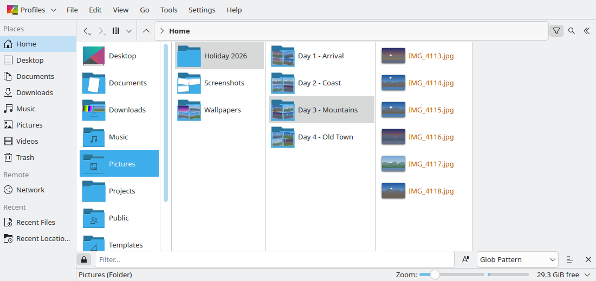
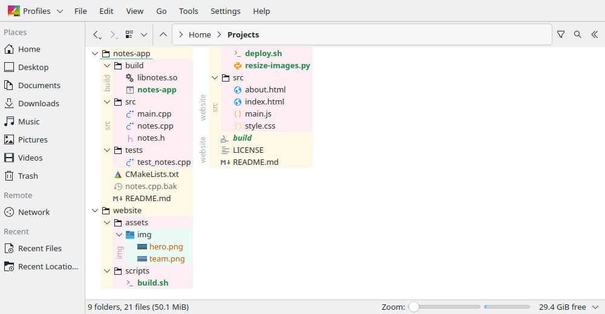
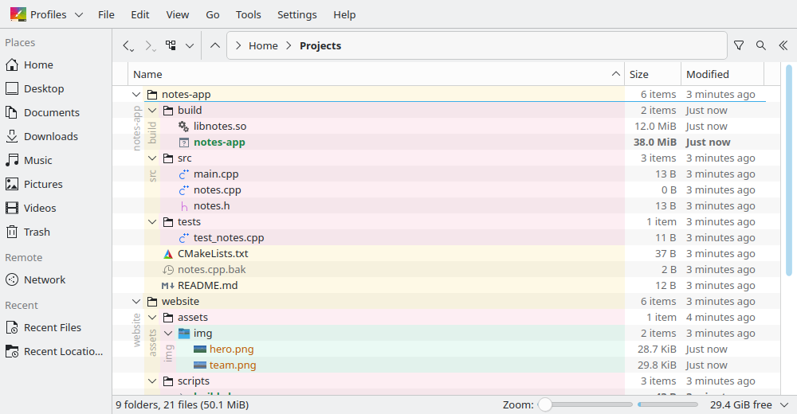
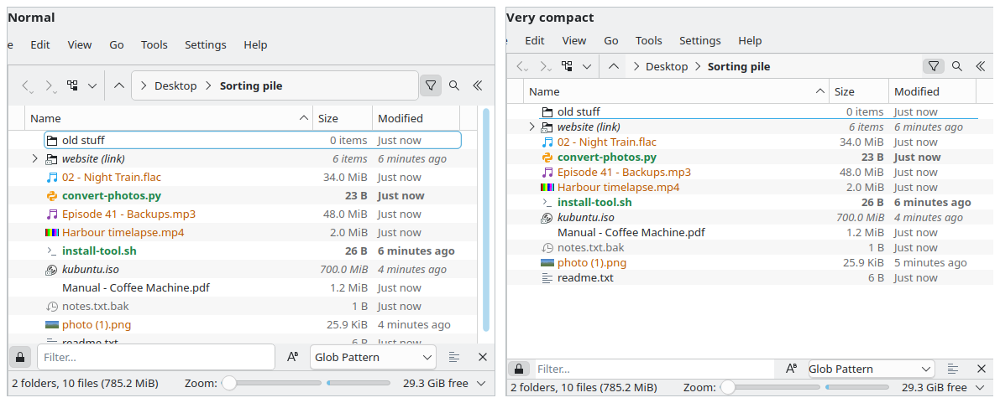
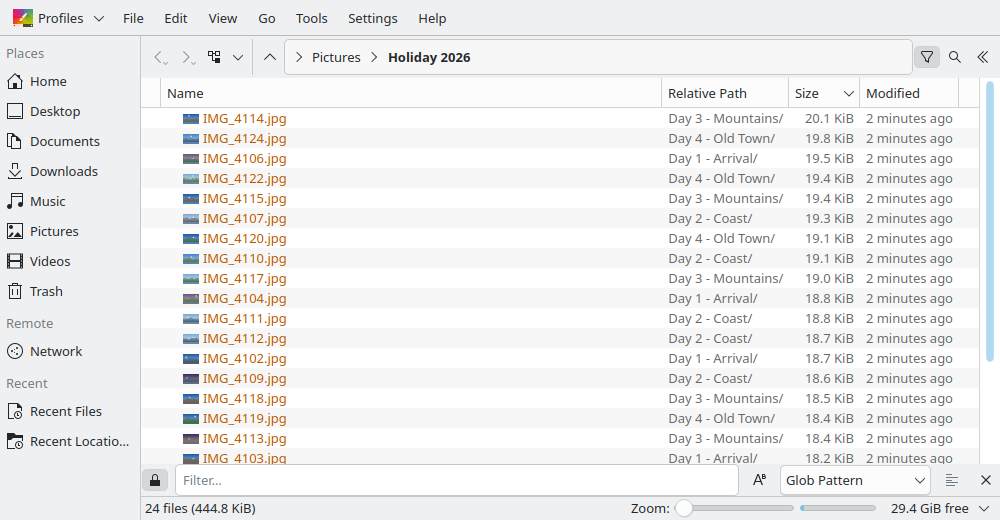

# Ansichten

## Mehr als Symbole, Kompakt und Details

Dolphin bringt drei Ansichtsmodi mit: Symbole, Kompakt und Details. Orcinus legt noch ein paar drauf und bringt den vorhandenen neue Tricks bei.

Alle Ansichten stehen gemeinsam im Menü *Ansicht* und im Ansichtsmodus-Knopf der Werkzeugleiste. Sind es mehr als fünf, rutschen sie in ein Untermenü *Ansichtsmodi*, damit das Menü nicht aus allen Nähten platzt.

<TODO-Bild (orcinus-view-modes.png): Der Ansichtsmodus-Knopf mit allen Ansichten>

## Die Spaltenansicht

Die Spaltenansicht (*Strg+4*, auch als „Miller Columns“ bekannt) stammt aus Dolphins Entwicklungsversion und ist in Orcinus der vierte Ansichtsmodus neben Symbolen, Kompakt und Details. Jeder Ordner auf dem Weg bekommt eine eigene Spalte. Wählst Du einen Ordner aus, öffnet er sich in einer neuen Spalte rechts daneben. Wer schon einmal einen Mac benutzt hat, fühlt sich gleich zuhause.

Orcinus macht ein paar Dinge zusätzlich möglich:

- Die Spaltenansicht kann in die Werkzeugleiste und in Profile, samt Zoom und Informationsdichte.
- In der geteilten Ansicht bleibt eine Spaltenansicht eine Spaltenansicht, auch wenn sie in einen anderen Ordner wechselt.
- Verknüpfte Ansichten funktionieren auch hier: Die andere Ansicht folgt dem zuletzt geöffneten Ordner, und ihre Auswahl erscheint in der Spalte dieses Ordners, ohne dass dabei etwas geöffnet wird.
- Der eingebaute Betrachter bewegt die Auswahl in der Spalte, aus der Du ihn geöffnet hast.

Nur *Flach anzeigen* gibt es hier nicht. Jede Spalte zeigt nun mal genau einen Ordner.

## Ansichts-Plugins

Weitere Ansichten können als **Plugins** dazukommen. Orcinus bringt eines mit, die *Cushion Treemap*. Die ist so schön, dass sie ein eigenes Kapitel bekommt.

Die Ansicht, die Du für einen Ort wählst, merkt sich Orcinus genau für diesen Ort (nicht für seine Unterordner), im Verlauf und in der Sitzung. Der Anzeigestil, der für den Ordner gespeichert ist, bleibt dabei unberührt. Dolphin bekommt davon also nichts mit. Optionen, die eine Ansicht nicht kann, bleiben sichtbar, sind aber ausgegraut.

## Aufklappbare Ordner in der Kompaktansicht

In der Detailansicht konntest Du Ordner schon immer aufklappen. Orcinus bringt das auch der **Kompaktansicht** bei: mit kleinen Pfeilen vor den Ordnern und ohne Baumlinien. Eingeschaltet ist das unter *Einstellungen → Orcinus einrichten … → Ansicht → Kompakt → Ordner: Aufklappbar*, und zwar standardmäßig.

### Ganze Zweige auf einmal

Einen Ordner nach dem anderen aufzuklappen, kann ganz schön mühsam sein. Deshalb gilt in Kompakt, Details und in der Seitenleiste *Ordner*:

- **Alt+Klick** auf einen Pfeil (oder die Taste **`*`**) klappt den **ganzen Zweig** auf oder zu, mit allen Unterordnern.
- **`+`** und **`-`** klappen eine Ebene auf und zu.

Damit Du Dir nicht aus Versehen Dein ganzes Dateisystem ins Fenster holst, folgt das Aufklappen ganzer Zweige keinen symbolischen Verknüpfungen und hört nach 10.000 Elementen auf.

## Farbige Hintergründe für aufgeklappte Ordner

In der Kompaktansicht hat das Aufklappen einen Haken: Ein aufgeklappter Ordner kann in die nächste Spalte umbrechen, und plötzlich weiß keiner mehr, wo sein Inhalt anfängt und wo er aufhört.

Orcinus **färbt deshalb den Inhalt aufgeklappter Ordner nach ihrer Tiefe ein**. So liest sich jeder Unterordner als ein Block. Für tiefere Ebenen wiederholen sich die Farben. Und wo Platz ist, stehen die **Namen der aufgeklappten Ordner senkrecht** in der Einrückung neben ihrem Inhalt.

In der Detailansicht funktioniert das in der Namensspalte genauso. Dort bleiben die Ordnernamen beim Scrollen durch einen langen Ordner oben stehen, Du weißt also immer, wo Du gerade bist. Die Baumlinien der Detailansicht werden dabei durch die Farben ersetzt.

Unter *Ansicht → Hervorhebung → Aufgeklappte Ordner* gibt es für beide Ansichten eine eigene Einstellung mit diesen Vorgaben:

- *Aus*
- *Druckerpapier*: für Nostalgiker, die noch Endlospapier mit grünen Streifen kennen
- *Grau*
- *Pastell (dezent)*
- *Pastell (kräftig)*: die Voreinstellung
- *Benutzerdefiniert*: 2 bis 10 eigene Farben
- nur für Details: *Klassisch (Baumlinien)*, Dolphins gewohntes Aussehen

Die Vorgaben passen sich hellen und dunklen Farbschemata an. Die Ordnernamen kannst Du abschalten oder über die *Deckkraft der Namen* dezenter machen.

## Informationsdichte

Dolphin lässt über und unter jedem Element 2 Pixel Platz. Klingt nach wenig, summiert sich bei ein paar hundert Dateien aber ganz schön.

Unter *Ansicht → Symbole / Kompakt / Details / Spalten → Dichte* stellst Du diesen Abstand für jeden Ansichtsmodus einzeln ein:

- **Normal:** 2 Pixel, wie in Dolphin.
- **Kompakt:** 1 Pixel. Das ist die Voreinstellung für neue Benutzer.
- **Sehr kompakt:** gar kein Abstand. Mit 16-Pixel-Symbolen und der üblichen Systemschrift ist eine Zeile dann etwa 18 statt 22 Pixel hoch. Das sind rund 22 % mehr Dateien auf dem Bildschirm, ganz ohne neuen Monitor.
- **Benutzerdefiniert:** der Abstand in Pixeln (0 bis 10) und, in Kompakt, Details und Spalten, die Zeilenhöhe in Prozent der Schrifthöhe (50 bis 150 %). Unter 100 % können sich die Buchstaben benachbarter Zeilen berühren. Ausprobieren auf eigene Gefahr.

In der Kompaktansicht schrumpft mit der Dichte auch der Abstand zwischen den Spalten (8, 6 und 4 Pixel). Der Platz links und rechts von Symbol und Name bleibt, wie er ist.

## Flach anzeigen

Manchmal interessieren Dich die Ordner überhaupt nicht. Du willst einfach **alle Dateien** sehen, zum Beispiel alle Fotos eines Urlaubs, egal in welchem Tagesordner sie stecken.

Dafür gibt es *Ansicht → Flach anzeigen (ohne Ordner)*. Die Ansicht zeigt dann alle Dateien aus allen Unterordnern in einer einzigen Liste, ganz ohne Ordner. In der Detailansicht gibt es dazu die Spalte *Relativer Pfad*, damit Du trotzdem weißt, woher eine Datei kommt.

Sortieren, Filtern, Auswählen und Vorschauen funktionieren ganz normal. Nach Größe sortiert findest Du so übrigens blitzschnell die dicksten Brocken in einem Ordnerbaum. Orcinus merkt sich die Einstellung für jeden Ort.

Weil eine flache Ansicht Dateien aus vielen Ordnern zeigt, kann darin nichts neu angelegt werden. Wohin auch? *Neu erstellen*, *Einfügen*, *Duplizieren* und Ablegen per Drag & Drop sind deshalb ausgegraut und sagen Dir auch, warum. Verschieben, Löschen, Umbenennen und Öffnen gehen natürlich.
