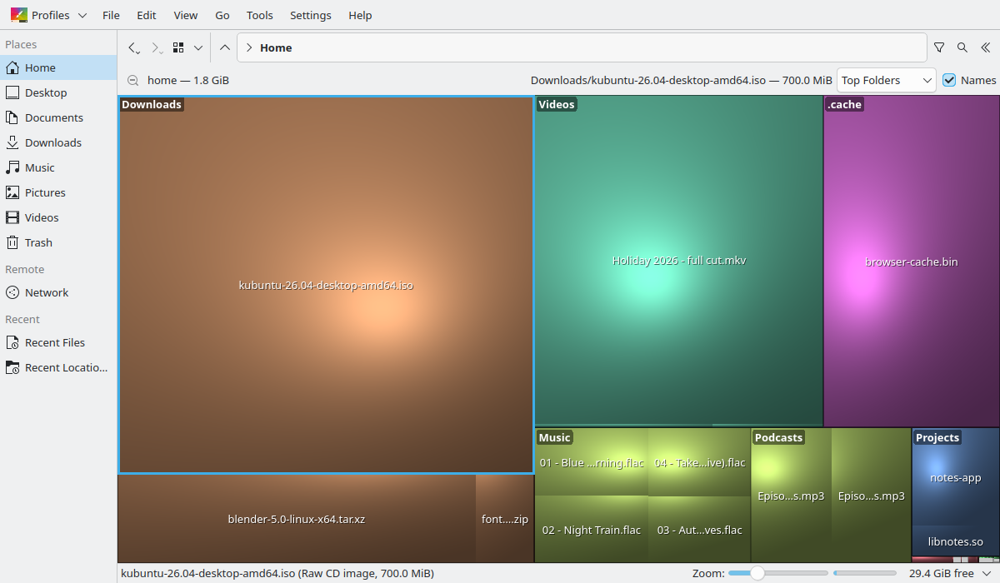
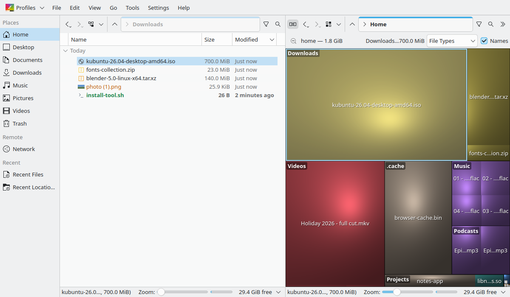

# Die Cushion Treemap

## Wo ist bloß mein Speicherplatz hin?

Die Festplatte ist voll. Schon wieder. Irgendwo liegen ein paar Gigabyte herum, aber wo? Die klassische Antwort sind Programme wie Filelight, KDirStat oder WinDirStat. Orcinus hat so etwas direkt eingebaut: die **Cushion Treemap**.

Die Treemap zeigt, wie der Platz unterhalb des aktuellen Orts verbraucht wird. **Jede Datei ist ein Rechteck**, dessen Fläche ihrer Größe entspricht, und **Ordner sind Gruppen von Rechtecken**. Die Polster-Schattierung („Cushion“) lässt die Ordnerstruktur plastisch hervortreten. Große Dateien springen Dir sofort ins Auge, und ein Ordner voller Kleinkram sieht aus wie ein Mosaik.

Versteckte Dateien zählen immer mit, denn auch sie belegen Platz. Gerade die versteckten Caches sind ja oft die größten Übeltäter.

Du findest die Treemap wie alle anderen Ansichten im Menü *Ansicht* und im Ansichtsmodus-Knopf.

## Farben und Namen

Über der Treemap sitzt eine kleine eigene Leiste. Links ist ein Knopf zum Herauszoomen und daneben der Pfad, in den Du gerade hineingezoomt hast. Rechts stehen Infos zum Element unter der Maus und die Einstellungen. In der Auswahlliste legst Du fest, wonach eingefärbt wird:

- **Dateitypen:** Bilder, Videos, Archive und so weiter bekommen jeweils eigene Farben. Ideal, um zu sehen, *was* den Platz frisst.
- **Oberste Ordner:** Jeder Ordner direkt unter dem aktuellen Ort bekommt eine Farbe. Ideal, um zu sehen, *wo* der Platz gefressen wird.

Mit **Namen** schreibt Orcinus die Datei- und Ordnernamen in die Rechtecke, sofern sie hineinpassen.

## Bedienung

- Ein **Klick** wählt ein Element aus. Ein **Doppelklick** oder **Eingabe** öffnet eine Datei oder wechselt in einen Ordner.
- Mit den **Pfeiltasten** springst Du zu den Nachbarn und zwischen den Ebenen.
- **Mausrad** und **`+`/`−`** zoomen in die Treemap hinein, ohne dass sich der Ort ändert. Praktisch, um sich einen Ordner genauer anzusehen, ohne den Überblick zu verlieren.
- Viele kleine Einträge werden zu einem Feld **„…“** zusammengefasst. Ein Klick darauf wählt ihren Ordner aus.

Die Auswahl funktioniert mit allen normalen Aktionen: Kopieren, Ausschneiden, In den Papierkorb werfen, Löschen, Umbenennen, Eigenschaften. Das Kontextmenü hat zusätzlich *Im Ordner zeigen* und *Im übergeordneten Ordner zeigen*.

Eine Sicherheitsleine gibt es auch: In der Treemap kann die Auswahl tief in irgendeinem Unterordner liegen, wo Du sie nicht direkt siehst. Deshalb fragen *In den Papierkorb werfen*, *Löschen* und *Ausschneiden* hier **immer** nach und zeigen die betroffenen Elemente an, auch wenn Du KDEs Bestätigungen abgeschaltet hast.

## Der Klassiker: Treemap und Details verknüpft

Am besten spielt die Treemap ihre Stärken in der **geteilten, verknüpften Ansicht** aus (siehe Kapitel „Geteilte Ansicht“): links die Detailansicht, rechts die Treemap. Klickst Du rechts auf das verdächtig große Rechteck, steht links sofort die Datei mit Name, Größe und Datum. Und umgekehrt.

Das fertige Profil **Verknüpfte Cushion Map** richtet Dir das mit einem Klick ein.

## Grenzen

- Die Treemap durchsucht nur **lokale Ordner** und bleibt dabei auf **einem Dateisystem**. Ein eingehängtes Netzlaufwerk unter Deinem Persönlichen Ordner bläht die Treemap also nicht auf.
- Weil sie Dateien aus vielen Ordnern zeigt, kann in ihr nichts angelegt, eingefügt oder abgelegt werden. Das geht wie bei der flachen Ansicht nur in einer normalen Ansicht.
