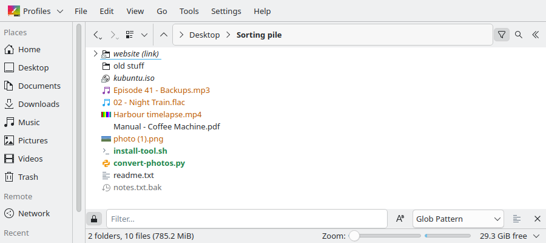

# Dateinamen hervorheben

## Bunt ist das neue Übersichtlich

Wer viel im Terminal arbeitet, kennt das farbige `ls`: Programme grün, Verknüpfungen türkis, Archive rot. Nach ein paar Tagen liest Du die Farben, ohne nachzudenken. Ein grüner Name? Ausführbar. Kursiv? Eine Verknüpfung.

Orcinus kann das auch. Unter *Ansicht → Hervorhebung → Dateinamen* färbst Du Dateinamen ein, machst sie **fett** oder *kursiv*, und zwar nach Regeln, die Du selbst bestimmst. Für neue Benutzer ist die Hervorhebung bereits eingeschaltet.

## Regeln

Eine Regel trifft zu auf

- **Ausführbare Dateien**,
- **Symbolische Verknüpfungen**,
- bestimmte **MIME-Typen**, z. B. `image/*` oder `text/x-python`,
- oder **Dateinamenmuster**, z. B. `*.bak` oder `Makefile` (ohne Beachtung der Groß-/Kleinschreibung, außer Du willst es anders).

Jede Regel gilt für Dateien, Ordner oder beides und legt Textfarbe, Fett und Kursiv fest. Jedes davon kannst Du auch auf *Unverändert* lassen.

<TODO-Bild (orcinus-name-highlighting-rule.png): Eine Regel bearbeiten>

### Wer gewinnt?

Die Regeln werden von oben nach unten abgearbeitet. **Für Farbe, Fett und Kursiv gewinnt jeweils die erste Regel, die es festlegt.** Eine Regel weiter oben, die nur „fett“ sagt, und eine darunter, die „rot“ sagt, ergeben also zusammen einen fetten roten Namen. Mit *Nach oben* und *Nach unten* bringst Du die Regeln in die richtige Reihenfolge.

### Farben

Farben kannst Du **aus dem Farbschema** nehmen oder **frei wählen**. Farben aus dem Farbschema passen sich hellen und dunklen Schemata an, Du musst also nach einem Wechsel auf ein dunkles Schema nichts nachjustieren. Frei gewählte Farben hält Orcinus lesbar, auch wenn Du Dich in einer schwachen Minute für Hellgelb auf Weiß entscheidest.

### Was heißt eigentlich „ausführbar“?

„Ausführbar“ bedeutet: Die Datei hat das Ausführbar-Bit auf einem Dateisystem, auf dem das etwas bedeutet. Auf FAT, exFAT und NTFS wird es ignoriert. Dort ist wegen der Einhänge-Optionen nämlich gern mal *alles* ausführbar, und Dein USB-Stick würde aussehen wie ein Weihnachtsbaum. Außerdem zählen `.exe`-Dateien als ausführbar.

## Die mitgelieferten Regeln

Ab Werk gibt es Regeln für ausführbare Dateien, symbolische Verknüpfungen (kursiv, wie in Dolphin) und Mediendateien. Hast Du Dich beim Herumspielen verrannt, holt *Voreinstellungen* sie zurück.
