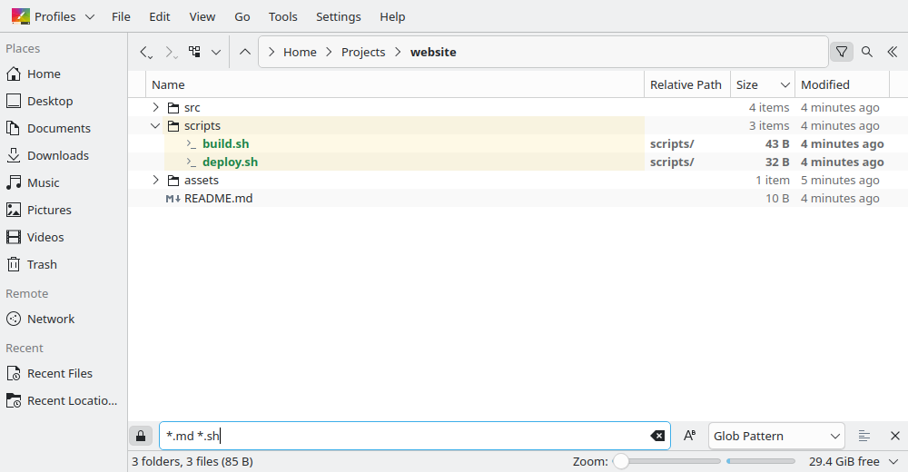

# Die Kleinigkeiten

## Nicht spektakulär, aber wertvoll

Nicht jede Verbesserung muss revolutionär sein. Oft sind es gerade die kleinen Dinge, die im täglichen Umgang mit einer Software den größten Unterschied machen.

Wenn man eine bestimmte Aktion hundertmal am Tag ausführt, kann bereits ein einziger eingesparter Mausklick eine erhebliche Verbesserung darstellen. Und manchmal geht es auch einfach nur darum, dass etwas angenehmer aussieht oder weniger Platz verschwendet.

Orcinus widmet diesen kleinen Dingen bewusst viel Aufmerksamkeit. Einige davon wirst Du vermutlich erst dann wirklich zu schätzen wissen, wenn Du wieder einmal mit einem anderen Dateimanager arbeitet.

Hier ist unsere Sammlung. Kein Anspruch auf Vollständigkeit, aber jede Menge eingesparte Klicks.

## Der Filter bleibt, wo er ist

In Dolphin wird der Filter bei jedem Ordnerwechsel gelöscht. Du filterst auf `*.jpg`, gehst einen Ordner tiefer, und alles ist wieder da. In Orcinus ist **Filter beim Wechsel der Ordner behalten** standardmäßig eingeschaltet und wird auch gemerkt. Willst Du den Filter loswerden, schließ einfach die Filterleiste. Dabei wird der Text gelöscht.

## Ordner bleiben sichtbar

Ein neuer Knopf in der Filterleiste legt fest, worauf der Filter wirkt:

- **Dateien (Ordner bleiben sichtbar):** die Voreinstellung. `*.jpg` versteckt also nicht mehr alle Ordner, und Du kannst weiter navigieren.
- **Ordner (Dateien bleiben sichtbar)**
- **Dateien und Ordner:** Dolphins Verhalten.

## Mehrere Muster auf einmal

Im Modus **Globbing-Ausdruck** kannst Du mehrere Muster angeben, getrennt durch Leerzeichen, Komma oder Semikolon: `*.jpg *.png *.webp`. Ein Element wird angezeigt, wenn es auf eines der Muster passt. Brauchst Du ein echtes Leerzeichen im Muster, nimm `?`.

## Zuletzt besuchte Ordner

*Datei → Zuletzt besuchte Ordner* listet die Ordner auf, in denen Du zuletzt warst, und zwar aus allen Fenstern. Ein Klick bringt Dich wieder hin. *Liste leeren* am Ende räumt auf. Wer das Menü öfter braucht, holt es sich über *Werkzeugleisten einrichten …* als Knopf in die Werkzeugleiste. Suchergebnisse landen übrigens nicht in der Liste.

## Umschalt+Doppelklick: einfach nur öffnen

**Umschalt+Doppelklick** (oder **Umschalt+Eingabe**) ist Dein „Mach einfach, was ich meine“-Kürzel:

- Bei einem Bild oder Video wird der eingebaute Betrachter übersprungen, und die Datei geht in ihrer Anwendung auf.
- Ein Skript wird immer in einem Terminal ausgeführt, das danach offen bleibt, egal, was in den Einstellungen steht. So siehst Du auch, was es ausgegeben hat.

## Skripte im Terminal ausführen

Apropos Skripte: Unter *Einstellungen → Orcinus einrichten … → Benutzeroberfläche → Bestätigungen → Beim Öffnen einer ausführbaren Datei* gibt es neben Dolphins *Immer nachfragen*, *In Anwendung öffnen* und *Skript ausführen* vier weitere Möglichkeiten:

- **Skript im Terminal ausführen:** Das Terminal bleibt offen, bis Du die Eingabetaste drückst.
- **Skript im Terminal ausführen und schließen:** Das Terminal schließt sich, wenn das Skript endet, außer es ist fehlgeschlagen.
- **Skript im minimierten Terminal ausführen**
- **Skript im minimierten Terminal ausführen und schließen**

Das Terminal startet im Ordner des Skripts. Geht etwas schief, bleibt es offen, und ein minimiertes Terminal kommt in den Vordergrund, damit Du die Fehlermeldung nicht verpasst.

## Ziehen von überall in der Zeile

In der Detailansicht von Dolphin startet ein Ziehen im leeren Teil einer nicht ausgewählten Zeile ein Auswahlrechteck, keinen Drag & Drop. Wer gern schnell mal eine Datei irgendwo hinzieht, greift dabei regelmäßig ins Leere.

Mit *Ansicht → Details → Ziehen: Dateien und Ordner von überall in der Zeile ziehen* ziehst Du stattdessen das Element. Brauchst Du doch ein Rechteck, halte dabei *Umschalt* gedrückt. Die Option ist standardmäßig aus, weil sie gewohntes Verhalten ändert.

## Symbolischen Verknüpfungen folgen

*Benutzeroberfläche → Ordner & Unterfenster → Symbolischen Verknüpfungen immer zu ihrem Ziel folgen* (standardmäßig aus): Öffnest Du einen Ordner über eine symbolische Verknüpfung, zeigt Orcinus ihn an seinem echten Ort. Die Adressleiste zeigt dann den Zielpfad statt des Pfads der Verknüpfung. Gut, wenn Du wissen willst, wo Du *wirklich* bist.

## USB-Sticks ohne Weihnachtsbaum-Effekt

FAT, NTFS und exFAT kennen kein Ausführbar-Bit. Viele Systeme hängen sie deshalb so ein, dass einfach *jede* Datei als ausführbar gilt. Kopierst Du davon etwas auf Deine Platte, war in Dolphin plötzlich jedes Urlaubsfoto ein „Programm“.

Orcinus entfernt dieses falsche Bit nach dem Kopieren oder Verschieben wieder. Ausgenommen sind echte Programme (ELF-Dateien und Skripte, die mit `#!` beginnen). Das gilt für Kopieren, Ausschneiden und Einfügen, Drag & Drop und *In andere Ansicht kopieren/verschieben*. Nur die Untermenüs *Kopieren nach* / *Verschieben nach* im Kontextmenü laufen über KIO und sind nicht abgedeckt.

## Und noch mehr Platz

Zwei Einstellungen, die eigentlich zu groß für dieses Kapitel sind, aber so gut zu „weniger Platz verschwenden“ passen, dass sie hier wenigstens erwähnt werden müssen:

- Die **Leistendichte** macht die Leisten rund um die Dateiansichten flacher (siehe Kapitel „Werkzeugleisten“).
- Die **Informationsdichte** rückt die Dateien in den Ansichten enger zusammen (siehe Kapitel „Ansichten“).

Beide stehen für neue Benutzer schon auf *Kompakt*. Wer es noch dichter mag: *Sehr kompakt*. Dein Bildschirm wird sich wundern, wie viel auf ihn draufpasst.
