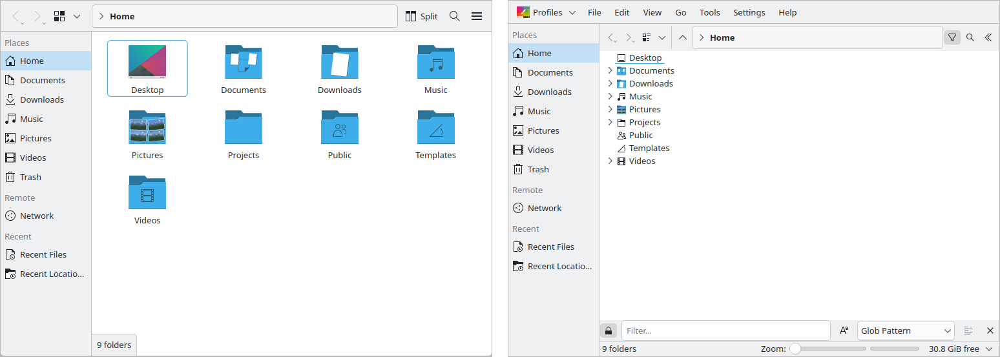

# Einführung in Orcinus

## Warum überhaupt Orcinus? Dolphin ist doch gut genug!

Ja, selbstverständlich ist Dolphin mehr als gut genug für die allermeisten seiner Benutzer.

Wer jedoch wie ich jahrzehntelang vom Windows Explorer gepeinigt wurde und deshalb schon vor langer Zeit auf Directory Opus umgestiegen ist – einen Dateimanager, der in einer ganz anderen Liga spielt –, vermisst bei Dolphin doch einiges.

Angefangen bei der schieren Informationsdichte über die farbliche Hervorhebung von Dateitypen bis hin zur „flachen“ Darstellung von Verzeichnisinhalten gibt es für einen Power-User, der einen großen Teil seines Tages im Dateimanager verbringt, durchaus noch Luft nach oben.

Aus diesem Bedürfnis heraus ist Orcinus entstanden.

Orcinus ist ein Fork von Dolphin. Ein großer Teil des Programms – derzeit rund 55 % des Codes – basiert daher weiterhin auf Dolphin. Oder, wenn man so will: Zwerge auf den Schultern von Riesen. Beziehungsweise Orcas auf den Flossen von Delfinen. Äh … so ungefähr.

Wer sich also mit Dolphin auskennt, wird sich in Orcinus auf den ersten Blick zurechtfinden.

Der erste Blick trügt jedoch – Orcinus ist nicht nur ein Delfin im schwarz-weißen Skin, sondern erweitert das stabile, bewährte Dolphin-Gerüst um eine Fülle nützlicher Funktionen.
Genau diese Funktionen zu entdecken und anwenden zu lernen, ist der Sinn dieses Handbuchs.

Bitte beachte, dass der erste Teil des Handbuchs direkt von Dolphin übernommen wurde. Das meiste trifft zu; wo es Abweichungen und neue Funktionen gibt, erfährst Du im zweiten, Orcinus-spezifischen Teil des Handbuchs.

**Unser Motto:**
*Make the common case simple and excellent.*
*Make the uncommon case possible.*
