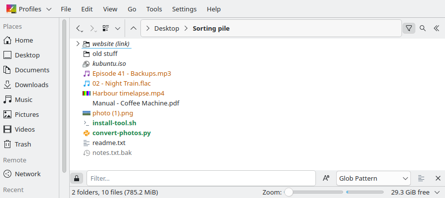
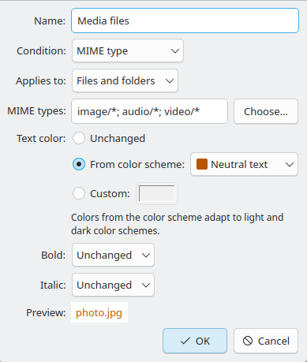

# Highlighting File Names

## Colorful is the new clear

If you work in the terminal a lot, you know the colored `ls`: programs in green, links in cyan, archives in red. After a few days you read the colors without thinking. A green name? Executable. Italic? A link.

Orcinus can do that too. On the settings page *View → Highlighting → File Names* you color file names, make them **bold** or *italic*, following rules you define yourself. For new users, highlighting is already switched on.

## Rules

A rule matches

- **Executable files**,
- **Symbolic links**,
- certain **MIME types**, e.g. `image/*` or `text/x-python`,
- or **file name patterns**, e.g. `*.bak` or `Makefile` (case-insensitive, unless you want it otherwise).

Each rule applies to files, folders or both, and sets text color, bold and italic. You can also leave any of these *Unchanged*.

### Who wins?

The rules are processed from top to bottom. **For color, bold and italic, the first rule that sets it wins, each on its own.** So a rule further up that only says "bold" and one below it that says "red" together give you a bold red name. With *Move Up* and *Move Down* you put the rules in the right order.

### Colors

You can take colors **from the color scheme** or **pick them freely**. Colors from the color scheme adapt to light and dark schemes, so you don't have to readjust anything after switching to a dark scheme. Freely picked colors are kept readable by Orcinus, even if in a weak moment you decide on light yellow on white.

### What does "executable" actually mean?

"Executable" means: the file has the executable bit on a file system where that means something. On FAT, exFAT and NTFS it's ignored. Because of the mount options, *everything* tends to be executable there, and your USB stick would look like a Christmas tree. In addition, `.exe` files count as executable.

## The rules that come with Orcinus

Out of the box there are rules for executable files, symbolic links (italic, as in Dolphin) and media files. If you've got yourself into a muddle while playing around, *Defaults* brings them back.
