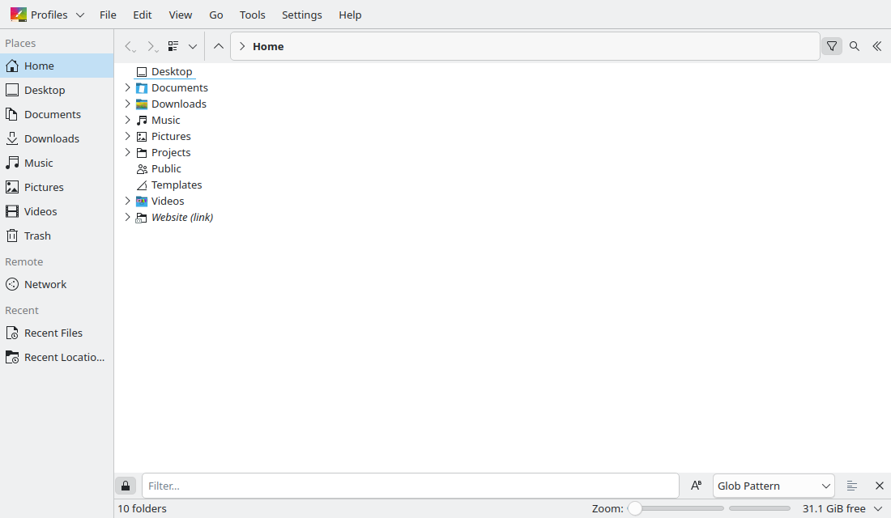

# Dolphin und Orcinus zusammen

## Das gemeinsame Biotop

Unser Ziel war es, dass Dolphin und Orcinus friedlich koexistieren können. Delfine und Orcas schwimmen ja auch im selben Meer, ohne sich ständig in die Flosse zu beißen.

Daher teilen sich Dolphin und Orcinus manche Ressourcen, während andere getrennt bleiben.

### Was Orcinus für sich behält

- **Eigene Identität:** Orcinus hat eine eigene App-ID (`io.github.arkarit.orcinus`), eine eigene Programmdatei (`orcinus`), eigene D-Bus-Namen, ein eigenes Icon und einen eigenen Eintrag in der Taskleiste. Wenn Du `dolphin` startest, bekommst Du Dolphin. Wenn Du `orcinus` startest, bekommst Du Orcinus. Keine Verwechslungsgefahr.
- **Eigene Konfiguration:** Orcinus speichert seine Einstellungen in `orcinusrc` (und ein paar Geschwisterdateien). Die Dolphin-Konfiguration `dolphinrc` wird weder gelesen noch geschrieben. Auch Werkzeugleisten, Tastenkürzel und Sitzungen sind getrennt. Du kannst Orcinus also nach Herzenslust umbauen, Dein Dolphin bleibt davon völlig unbeeindruckt.

### Was sich beide teilen

Ganz bewusst gemeinsam (und übrigens auch mit anderen KDE-Programmen) genutzt werden:

- die **Orte** in der Seitenleiste,
- der **Papierkorb**,
- die **Lesezeichen**,
- die **Dienstmenüs** (die Einträge im Kontextmenü unter „Aktionen“),
- die **„Neu erstellen“-Vorlagen**,
- die Desktop-Suche **Baloo**,
- der **Vorschaubild-Cache** (Vorschauen, die Dolphin schon erzeugt hat, muss Orcinus nicht noch einmal berechnen),
- der **Anzeigestil, der für einzelne Ordner gespeichert wird**.

Außerdem benutzt Orcinus Dolphins Plugins für Versionsverwaltung (aus dem Paket `dolphin-plugins`, z. B. für Git), seine Dienstmenüs und den ersten Teil seines Handbuchs, sofern sie installiert sind. Dolphin selbst muss dafür nicht installiert sein.

### Orcinus als Standard-Dateimanager

Wenn Dir Orcinus so gut gefällt, dass Du ihn für alles benutzen möchtest: In den *Systemeinstellungen → Standard-Anwendungen → Dateiverwaltung* kannst Du Orcinus als Standard-Dateimanager eintragen. Dann öffnen sich Ordner aus anderen Programmen in Orcinus.

Eine Ausnahme gibt es (noch): „Im Ordner anzeigen“ aus dem Browser und anderen Programmen läuft über eine eigene Schnittstelle (`org.freedesktop.FileManager1`), und die bleibt in dieser Version bei Dolphin. Wundere Dich also nicht, wenn nach einem Download plötzlich doch ein Delfin auftaucht.

### Wenn's mal knallt

Abstürze kommen in den besten Familien vor. Wenn Du einen Absturzbericht sendest, geht dieser an den Issue-Tracker von Orcinus und nicht an die Dolphin-Entwickler auf bugs.kde.org. Die können für unsere Fehler schließlich nichts.

Unter *Hilfe → Über Orcinus* siehst Du übrigens auch, auf welcher Dolphin-Version Dein Orcinus basiert. Im Reiter *Autoren* stehen zuerst die Orcinus-Autoren und danach die Dolphin-Entwickler, auf deren Flossen wir stehen.

## Frisch eingezogen: die Voreinstellungen

Wenn Du Orcinus zum ersten Mal startest, bekommst Du nicht Dolphins Voreinstellungen, sondern unsere eigenen. Wir finden, dass sie für Power-User besser passen:

- Die **Hauptwerkzeugleiste** ist kurz: Profile, die Menüleiste als Element und der Menüknopf. Die Navigationsknöpfe stecken nämlich in den Werkzeugleisten der Dateiansichten (mehr dazu im Kapitel „Werkzeugleisten“).
- Jede Dateiansicht hat eine **eigene Werkzeugleiste** mit Zurück, Vor, Ansichtseinstellungen, Hoch, Adressleiste, Filter und Suche.
- Es gibt **sieben fertige Profile**, beim ersten Start ist *Kompakt* aktiv.
- Die **Hervorhebung von Dateinamen** ist eingeschaltet.
- Die **Filterleiste** ist in neuen Fenstern sichtbar (nur beim allerersten Start blendet das Profil *Kompakt* sie aus).
- Die **Statusleiste** geht über die ganze Fensterbreite und hat den Zoom-Schieberegler.
- Die Vorschaubilder der Kompaktansicht sind 16 Pixel groß.
- **Informationsdichte** und **Leistendichte** stehen auf *Kompakt*. Es passt also mehr auf den Bildschirm.

Und wenn Du Orcinus schon länger benutzt? Dann bleibt alles, wie es war. Neue Funktionen, die etwas Gewohntes verändern würden, sind bei Dir standardmäßig ausgeschaltet. Deine Einstellungen und Werkzeugleisten fassen wir nicht an. Wer neugierig ist, schaltet sie einfach selbst ein.
