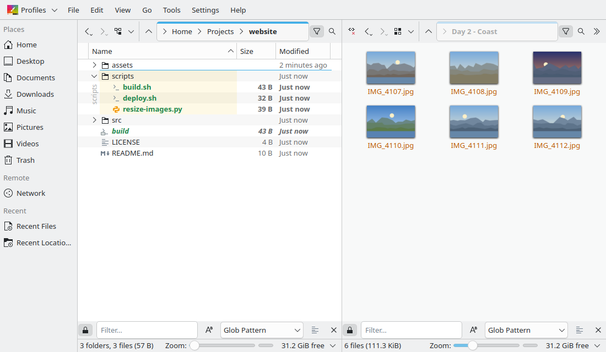
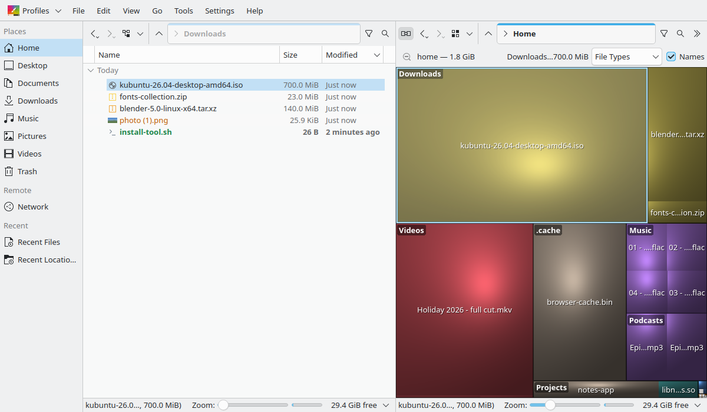

# Geteilte Ansicht

## Zwei Hälften, zwei Meinungen

Die geteilte Ansicht (*F3*) kennst Du schon aus Dolphin: links ein Ordner, rechts ein anderer, dazwischen fliegen Dateien hin und her. Orcinus baut darauf auf und lässt jede Hälfte ein bisschen mehr sie selbst sein.

### Jede Ansicht behält ihren Anzeigestil

In Dolphin steht unter *Einstellungen → Dolphin einrichten … → Ansicht → Allgemein* standardmäßig *Für alle Ordner den gleichen Anzeigestil verwenden*. „Für alle Ordner“ heißt dort aber auch „für beide Ansichten“: Welche Ansicht Du zuletzt umgestellt hast, entscheidet, wie die andere im nächsten Ordner aussieht. Nach einem Neustart sehen ohnehin beide gleich aus. Links Details, rechts Symbole? Hält genau bis zum nächsten Ordnerwechsel.

In Orcinus **behält jede Ansicht ihren eigenen Anzeigestil** (Ansichtsmodus, Sortierung, versteckte Dateien, Vorschauen, Spalten), auch wenn sie in einen anderen Ordner wechselt. Orcinus merkt sich das für die Seite (links oder rechts), und genau so starten dann auch neue Fenster, Unterfenster und geteilte Ansichten.

Ein paar Orte haben ihren eigenen Stil, etwa Papierkorb, Suche, zuletzt benutzte Dateien und Downloads. Die zeigen ihn weiterhin, und wenn Du sie verlässt, bekommt die Ansicht ihren eigenen Stil zurück.

Löst Du eine Ansicht heraus (*Rechte Ansicht herauslösen*) oder verwandelst Du die Hälften in Unterfenster (*Geteilte Ansicht zu Unterfenstern*), nimmt sie ihren Stil einfach mit.

Arbeitest Du mit *Anzeigestil für jeden Ordner merken*, ändert sich übrigens gar nichts gegenüber Dolphin.

### Geteilt starten – oder nicht

Unter *Benutzeroberfläche → Ordner & Unterfenster → Neue Fenster und Unterfenster teilen* legst Du fest, ob neue Fenster und Unterfenster geteilt starten:

- **Wie zuletzt** (Voreinstellung): So, wie Du zuletzt gearbeitet hast.
- **Immer**
- **Nie**

Das ersetzt Dolphins Ankreuzfeld „Neue Fenster in geteilter Ansicht öffnen“. Falls das bei Dir an war, wird daraus *Immer*.

## Verknüpfte Ansichten

Jetzt wird's richtig spannend. Am linken Ende der Werkzeugleiste der rechten Ansicht sitzt ein Knopf mit einem **Kettenglied**. Damit verknüpfst Du die beiden Ansichten miteinander:

- **Gleicher Ordner:** Beide Ansichten zeigen immer denselben Ordner. Beim Verknüpfen übernimmt die rechte Ansicht den Ort der aktiven.
- **Gespiegelte Auswahl:** Was Du in der einen Ansicht auswählst, wird auch in der anderen ausgewählt.
- **Mitlaufen:** Kann die andere Ansicht das Element an seiner Stelle gar nicht zeigen, weil sein Ordner dort zum Beispiel nicht aufgeklappt ist, wechselt sie kurzerhand in diesen Ordner. Kommt die Auswahl zurück, wechselt sie auch wieder zurück.

Wozu das Ganze? Stell Dir vor, Du hast auf der einen Seite eine Ansicht, die Zusammenhänge zeigt (zum Beispiel die Cushion Treemap mit dem Platzverbrauch), und auf der anderen eine, die Details zeigt. Klickst Du in der Treemap auf ein dickes Rechteck, siehst Du daneben sofort, um welche Datei es geht, mit Größe, Datum und allem. Das fertige Profil *Verknüpfte Cushion Map* macht genau das.

Damit die Auswahl auf beiden Seiten zueinander passt, gibt es ein paar Spielregeln, solange die Ansichten verknüpft sind:

- Mehrere Elemente kannst Du nur **innerhalb eines Ordners** auswählen. *Strg+Klick* in einen anderen Ordner wird abgelehnt, *Umschalt+Klick* und das Auswahlrechteck bleiben im Ordner, und *Alles auswählen* wählt den Ordner des aktuellen Elements aus. Eine kurze Meldung erklärt Dir das jeweils.
- Verknüpfen kannst Du nur **lokale Ordner**. Wechselst Du zu FTP, SMB, in den Papierkorb oder in Suchergebnisse, wird die Verknüpfung mit einer Meldung gelöst.

Die Verknüpfung gehört zum Unterfenster und ist nach einem Neustart wieder aus. Wenn Du sie öfter brauchst, speicher sie einfach in einem Profil (siehe Kapitel „Profile“).
