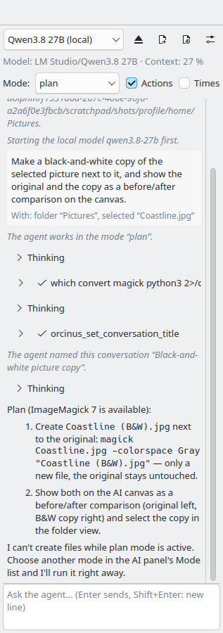
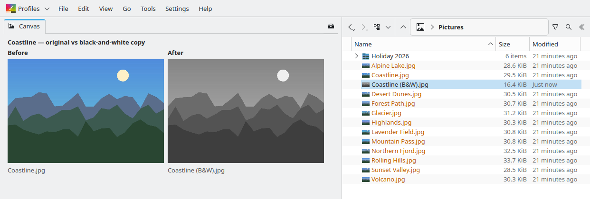

# KI-Unterstützung

## Ein Assistent im Dateimanager

„Gib den 300 Fotos hier sinnvolle Namen.“ „Warum ist mein Home-Ordner so groß?“ „Bau mir ein Werkzeug, mit dem ich Fotos schnell aussortieren kann.“ Solche Dinge kann Dir ein KI-Agent abnehmen, und Orcinus gibt ihm dafür einen Platz direkt neben Deinen Dateien.

Orcinus redet dabei mit einem **KI-Agenten, der auf Deinem Rechner läuft**, zum Beispiel Claude Code, Codex oder OpenCode mit einem lokalen Modell. Du schreibst in einer Seitenleiste. Der Agent sieht, welchen Ordner Du offen hast und was Du ausgewählt hast, und er kann Ordner öffnen, Dateien auswählen und Orcinus für Dich bedienen.

Orcinus selbst ruft **keinen KI-Dienst** auf. Anmeldung, Modell, Abrechnung und die Werkzeuge des Agenten bleiben Sache des Agenten. Ab Werk ist nichts eingerichtet, und nichts verlässt Deinen Rechner, bevor Du selbst einen Agenten hinzufügst.

Wie Du einen Agenten einrichtest, steht im Kapitel „KI-Agenten einrichten“.

## Bevor Du loslegst: ein ernstes Wort

Hier hört der Spaß kurz auf. Ein Agent arbeitet **mit Deinen Rechten**. Er kann Deine Dateien lesen, ändern und löschen, Programme starten und, wenn Du es erlaubst, nach Administratorrechten fragen. Orcinus hat keine eigene Sandbox.

- Wenn KI-Agenten neu für Dich sind, probier sie zuerst in einer **virtuellen Maschine** aus.
- Mach **Sicherungen** von allem, was Dir wichtig ist.
- Wenn Du nicht verstehst, was der Agent vorhat: **Frag ihn**, bevor Du es erlaubst.
- Wenn Du einen Cloud-Agenten benutzt, gehen die Inhalte, die der Agent liest (Dateien, Befehlsausgaben, Pfade), an die Server des Anbieters. Sei Dir dessen bewusst.

Beim ersten Öffnen erklärt Dir ein Dialog genau das. Erst wenn Du ihn bestätigt hast, funktioniert die Seitenleiste.

## Die Seitenleiste „KI-Assistent“

Du öffnest sie mit **F8** oder über *Ansicht → Seitenleisten → KI-Assistent*. Oben wählst Du den Agenten, beginnst ein neues Gespräch, öffnest ein gespeichertes oder springst in die Einstellungen (*Einstellungen → Orcinus einrichten … → KI-Unterstützung*).

### Modi und Erlaubnisse

Ein frisch eingerichteter Agent startet in seinem **vorsichtigsten Modus**, etwa *Plan* oder *Nur lesen*. Er darf sich also umsehen, fragt aber, bevor er etwas ändert. Über das Feld *Modus* unter dem Namen des Agenten lockerst Du das. Der Modus, den Du dort wählst, gilt auch beim nächsten Start.

Will der Agent etwas tun, das sein Modus nicht erlaubt, **fragt er im Gespräch**, und Du antwortest dort. Wartet eine Frage, öffnet sich die Seitenleiste von selbst, damit der Agent nicht ewig Däumchen dreht.

### Was der Agent sieht

Mit jeder Nachricht bekommt der Agent den Ordner der aktiven Ansicht, die ausgewählten Elemente und den Ordner der anderen Hälfte der geteilten Ansicht. Die Zeile unter Deiner Nachricht zeigt, was mitgeschickt wurde. Dateien, die Du auf das Eingabefeld ziehst, kopierte Dateien und eingefügte Bilder gehen als kleine „Chips“ mit.

### Was der Agent in Orcinus tun kann

Er kann Ordner öffnen, Dateien auswählen, den Ansichtsmodus wechseln, die Ansicht teilen, eine Reihe von Einstellungen und Profilen ändern und die meisten Aktionen aus den Menüs ausführen. Jede dieser Aktionen erscheint als Zeile im Gespräch. Mit dem Feld *Aktionen* blendest Du sie aus.

#### Grenzen

Orcinus gibt dem Agenten keine Funktion, seine eigenen KI-Einstellungen zu ändern. Er kann höchstens einen neuen Agenten vorschlagen, den Du dann selbst hinzufügst. Über das Dateisystem könnte ein Agent das aber umgehen. Also: immer wachsam bleiben.

#### Kein Rückgängig für den Agenten

Orcinus kann nicht zurücknehmen, was ein Agent tut. Er kann außerhalb von Orcinus Programme starten, Dateien ändern oder löschen und Systemeinstellungen verstellen. Das liegt außerhalb der Kontrolle von Orcinus. Im Zweifel machst Du vorher ein Backup, oder Du bittest den Agenten, eins zu machen.

### Befehle

Eine Nachricht, die mit `/` beginnt, ist ein Befehl und geht direkt an den Agenten, zum Beispiel `/usage` bei Claude (zeigt die 5-Stunden- und Wochenlimits) oder `/status` bei Codex. Tippst Du nur `/`, listet Orcinus alle Befehle von Orcinus und vom Agenten auf.

### Verbrauch

Die Zeile unter dem Namen des Agenten zeigt das Modell und wie voll der Kontext ist. Ihr Tooltip listet die Tokens des Gesprächs und, wenn der Agent sie meldet, die Kosten. Bei einem Abo sind das die Kosten, die dieselbe Nutzung über die API verursachen würde. Gut zu wissen, aber kein Grund zur Panik.

### Vorschläge

Ein neues Gespräch bietet Dir ein paar Vorschläge zum Einstieg an: Dateien umbenennen, das System prüfen, ein Problem mit Orcinus melden und so weiter. Ein Klick setzt den Text ins Eingabefeld, wo Du ihn ergänzen kannst. Abgeschickt wird erst, wenn Du die Eingabetaste drückst.

### Administratorrechte

Ist es erlaubt (*KI-Unterstützung → Agenten → Administratorrechte → Agenten dürfen nach Administratorrechten fragen*, standardmäßig an), darf der Agent einzelne Befehle über `pkexec` als Administrator ausführen. Das System fragt dann **jedes Mal** nach Deinem Passwort. Lies vorher genau, was da ausgeführt werden soll.

## Gespräche und Gedächtnis

- **Gespräche speichern** (*KI-Unterstützung → Gedächtnis → Gespräche*, standardmäßig an, 90 Tage lang): Der Knopf *Gespeicherte Gespräche* listet sie auf. Ein Agent, der das kann, setzt ein gespeichertes Gespräch genau da fort, wo es aufgehört hat. Im selben Menü kannst Du das angezeigte Gespräch als PDF, Markdown oder Text **exportieren**.
- **Sprache:** Die Agenten antworten in der Sprache von Orcinus oder in der, die Du unter *Mit Agenten sprechen in* einstellst.
- **Gedächtnis:** kurze Notizen, die der Agent in jedes Gespräch mitbekommt, für alle Ordner oder für einen Ordner und seine Unterordner. Etwa: „Rechnungen kommen in einen Ordner pro Jahr, PDFs behalten ihre Namen.“
  - *Manuell* (Voreinstellung): Der Agent schlägt eine Notiz vor, und Du behältst oder verwirfst sie.
  - *Automatisch*: Der Agent merkt sich Dinge selbst.
  - *Aus*.

  Selbst eine Notiz schreiben kannst Du mit `/remember …` (für den angezeigten Ordner) oder `/remember global …`. Die Notizen gelten für alle Agenten und sind getrennt von deren eigenem Gedächtnis.
- **Systemprompt** (*KI-Unterstützung → Systemprompt*): Das erzählt Orcinus jedem Agenten zu Beginn. Du kannst es durch Deinen eigenen Text ersetzen.

## Lokale Modelle

Agenten wie OpenCode können statt mit einem Cloud-Dienst auch mit einem **Modell auf Deiner eigenen Grafikkarte** arbeiten. Dann verlässt nichts Deinen Rechner (solange Dein Setup selbst keine Daten weitergibt), und eine Rechnung gibt es auch nicht. Na gut, außer der Stromrechnung. Und den Raten für die Grafikkarte, die zwischen ein paar hundert Euro und einem fünfstelligen Betrag kosten kann. Aber sonst nix, versprochen. Dafür braucht es eine Karte mit genug Speicher (mit 16 GB kann man schon einiges anfangen, besonders mit Strata), und ein lokales Modell ist meist langsamer und weniger fähig als die großen Cloud-Modelle.

Orcinus findet die Modelle von **LM Studio** und **Strata**: *KI-Unterstützung → Agenten → Hinzufügen → Lokales Modell (LM Studio) …* (oder *(Strata)*) legt einen Agenten für eines davon an.

Orcinus startet den Modellserver, wenn ein Gespräch ihn braucht, und entlädt das Modell wieder, wenn das Gespräch endet oder die Seitenleiste länger versteckt bleibt. So blockiert es nicht dauerhaft den Grafikspeicher, und Dein Spiel am Feierabend ruckelt nicht. Mit dem Knopf neben dem Agenten lädst oder entlädst Du das Modell von Hand.

## Die KI-Leinwand und ihre Werkzeuge

*Ansicht → Seitenleisten → KI-Leinwand* ist der Ort, an dem der Agent seine Arbeit zeigt: Bilder und Videos, die er erzeugt hat, Dateien, die er gefunden hat, Töne, Texte und Vorher-Nachher-Vergleiche. Ein Klick auf ein Element zeigt die Datei in der Ansicht.

Auf Wunsch baut Dir der Agent auch kleine **Werkzeuge** für die Leinwand: ein eigenes Fenster mit Knöpfen, Listen und Vorschauen (Qt Quick), wahlweise mit einem Python-Programm dahinter. Zum Beispiel: „Geh die Fotos in diesem Ordner durch und lass mich jedes behalten oder verwerfen.“ Ein Werkzeug öffnet sich als Reiter der Leinwand. Mit *Auf der Leinwand behalten* bleibt es auch für den nächsten Start da.

Der Werkzeuge-Knopf listet Deine Werkzeuge auf und bietet **Beispielwerkzeuge** an (*Beispielwerkzeug hinzufügen*, etwa *Photo Triage* zum Aussortieren von Fotos).

Werkzeuge laufen, genau wie der Agent, mit Deinen Rechten. Das Programm eines Werkzeugs, das Du noch nicht behalten hast, startet deshalb erst, nachdem Du es bestätigt hast.

## Die KI-Werkbank

Wenn Du Assistent und Leinwand zusammen nutzen willst, nimm einfach das Profil **KI-Werkbank**: links die Leinwand, in der Mitte die Detailansicht, rechts der Assistent. Alles, was Du brauchst, auf einen Blick. Weil drei Bereiche nebeneinander viel Platz brauchen, empfehlen wir dafür mindestens Full HD (1920 × 1080).
