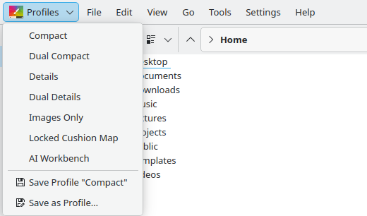
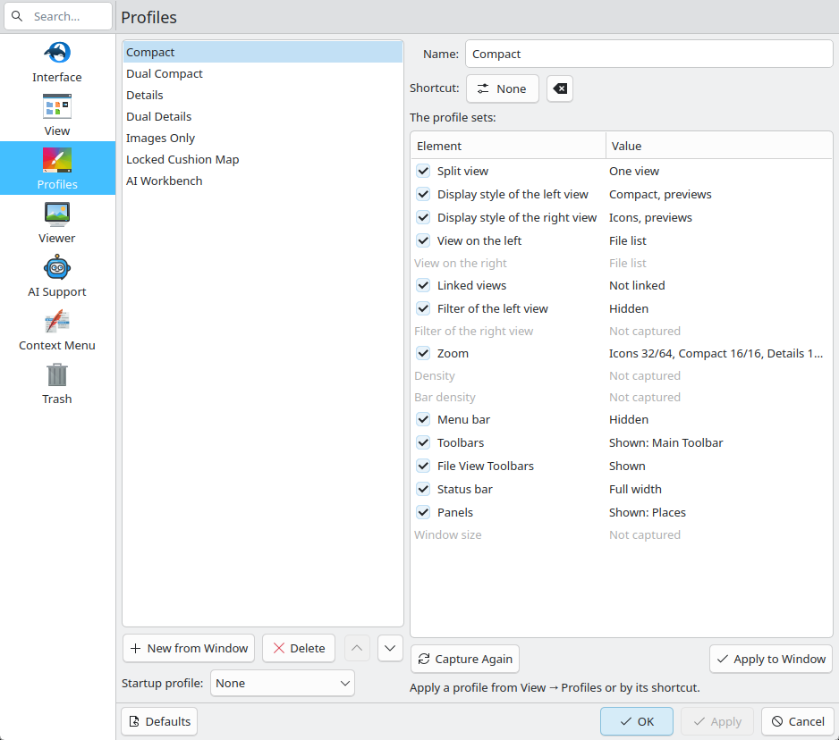
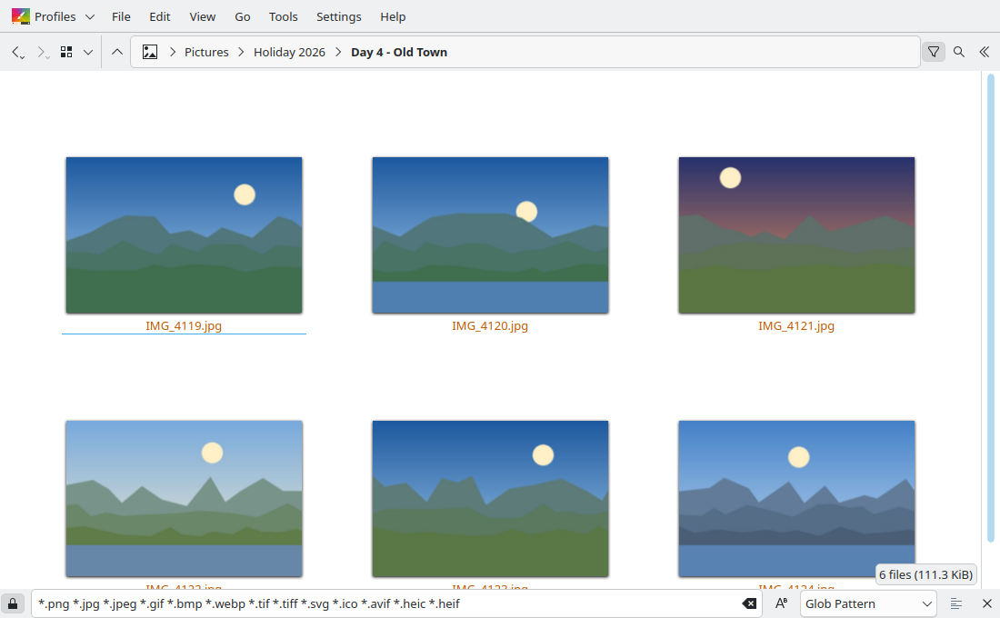

# Profile

## Ein Klick, ein ganz anderes Fenster

Du kennst das: Für die tägliche Arbeit willst Du ein schlankes Fenster, eine Ansicht, Kompakt, keine Seitenleisten. Zum Aufräumen brauchst Du zwei Ansichten nebeneinander, beide in Details. Und für Fotos sollen es große Vorschaubilder sein, mit der Informations-Seitenleiste. Jedes Mal alles von Hand umzustellen, ist ungefähr so spaßig wie Socken sortieren.

Genau dafür gibt es **Profile**. Ein Profil schaltet das komplette Aussehen eines Fensters auf einmal um.

## Was ein Profil alles kann

Ein Profil kann festlegen:

- ob die Ansicht **geteilt** ist,
- den **Anzeigestil** und die **Ansicht** jeder Seite (also z. B. links Kompakt, rechts Cushion Treemap),
- ob die Ansichten **verknüpft** sind,
- den **Zoom**,
- die **Informationsdichte** und die **Leistendichte**,
- die **Filterleiste** jeder Seite (inklusive Filter, z. B. nur Bilder),
- **Menüleiste**, **Werkzeugleisten**, **Werkzeugleisten der Dateiansichten** und **Statusleiste**,
- die **Seitenleisten**,
- die **Fenstergröße** (Größe oder maximiert; die Position nicht, denn die dürfen Programme unter Wayland nicht bestimmen).

Das Schöne: Elemente ohne Häkchen lässt ein Profil einfach in Ruhe. Ein Profil kann also auch nur zwei, drei Dinge umschalten und den Rest so lassen, wie er ist.

## Profile anwenden und speichern

- **Anwenden:** ein Klick auf das Profil unter *Ansicht → Profile* bzw. im Profile-Knopf der Hauptwerkzeugleiste. Oder ein Tastenkürzel, das Du ihm gibst.
- **Neu speichern:** Richte das Fenster so ein, wie Du es haben möchtest, und wähle *Ansicht → Profile → Als Profil speichern …*. Fertig.
- **Aktualisieren:** *Profil „…“ speichern* übernimmt den aktuellen Zustand des Fensters in das zuletzt angewendete Profil. Ideal für „Ach, die Seitenleiste hätte ich doch gern noch dabei“.

Ein angewendetes Profil ist außerdem das, womit neue Fenster, Unterfenster und geteilte Ansichten starten.

Ein kleiner Haken: Die Anzeigestile eines Profils werden nur angewendet, wenn *Für alle Ordner den gleichen Anzeigestil verwenden* eingestellt ist (das ist die Voreinstellung). Merkt sich jeder Ordner seinen eigenen Stil, hat das Profil da nichts zu melden.

## Die Einstellungsseite „Profile“

Unter *Einstellungen → Orcinus einrichten … → Profile* findest Du alle Profile in einer Liste. Dort kannst Du

- die **Reihenfolge** ändern,
- **Name** und **Tastenkürzel** vergeben,
- für jedes Profil sehen und festlegen, **welche Elemente** es umschaltet und auf welche Werte,
- mit *Neu aus Fenster* ein Profil aus dem aktuellen Fenster anlegen,
- mit *Neu erfassen* ein bestehendes Profil mit dem aktuellen Fenster überschreiben,
- und mit *Auf Fenster anwenden* ein Profil gleich ausprobieren.

### Das Startprofil

Ebenfalls auf dieser Seite: das **Startprofil**. Jedes neue Fenster öffnet sich dann mit diesem Profil. Es wird über das gelegt, was Orcinus sich gemerkt hat. Auch wenn Du *Offene Ordner und Unterfenster merken* eingeschaltet hast, bekommst Du also Deine Ordner und Unterfenster zurück, aber im Aussehen des Startprofils.

Die Fenstergröße eines Profils wird übrigens nur beim Start angewendet. Wenn Du in einem offenen Fenster das Profil wechselst, springt das Fenster nicht plötzlich auf eine andere Größe. Das wäre auch ziemlich irritierend.

## Die mitgelieferten Profile

Neue Benutzer bekommen sieben fertige Profile, die Du direkt aus der Hauptwerkzeugleiste anwenden kannst:

| Profil | Was es macht |
|---|---|
| **Kompakt** | Eine Ansicht in Kompakt. Wird beim ersten Start angewendet. |
| **Kompakt geteilt** | Zwei Ansichten nebeneinander, beide Kompakt. |
| **Details** | Eine Ansicht in Details. |
| **Details geteilt** | Zwei Ansichten nebeneinander in Details. |
| **Nur Bilder** | Große Symbole, auf Bilddateien gefiltert, keine Seitenleisten. |
| **Verknüpfte Cushion Map** | Details und Cushion Treemap nebeneinander, verknüpft. |
| **KI-Werkbank** | Details zwischen der KI-Leinwand links und dem KI-Assistenten rechts. |

Die Profile werden einmal angelegt. Löschst Du eines, kommt es nicht ungefragt zurück. Versprochen.

