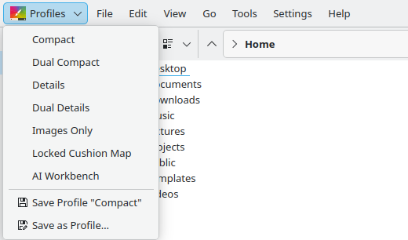
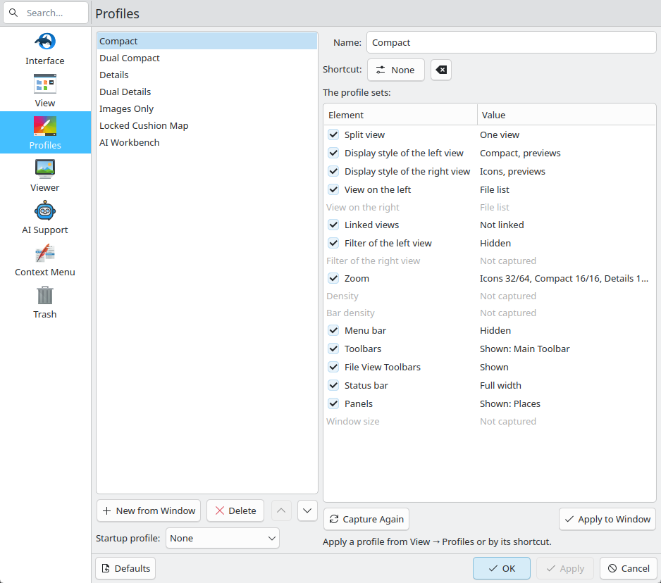
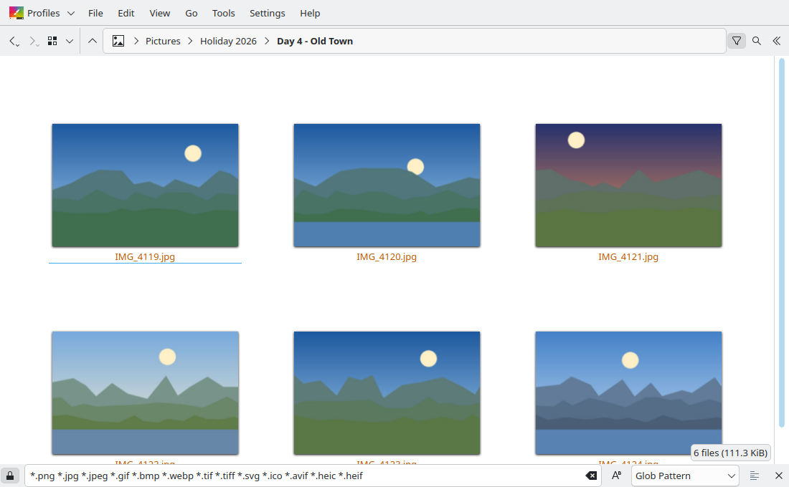

# Profiles

## One click, a completely different window

You know how it is: for everyday work you want a slim window, one view, Compact, no panels. For tidying up you need two views side by side, both in Details. And for photos it should be big previews, with the Information panel. Changing everything by hand every time is about as much fun as sorting socks.

That's exactly what **profiles** are for. A profile switches the complete look of a window at once.

## What a profile can do

A profile can set:

- whether the view is **split**,
- the **display style** and the **view** of each side (e.g. Compact on the left, Cushion Treemap on the right),
- whether the views are **linked**,
- the **zoom**,
- the **information density** and the **bar density**,
- the **filter bar** of each side (including the filter, e.g. images only),
- **menu bar**, **toolbars**, **file view toolbars** and **status bar**,
- the **panels**,
- the **window size** (size or maximized; not the position, because applications aren't allowed to decide that under Wayland).

The nice part: a profile simply leaves unchecked elements alone. So a profile can also switch just two or three things and leave the rest the way it is.

## Applying and saving profiles

- **Apply:** one click on the profile in *View → Profiles* or in the Profiles button of the main toolbar. Or a keyboard shortcut you give it.
- **Save a new one:** set up the window the way you want it and choose *View → Profiles → Save as Profile…*. Done.
- **Update:** *Save Profile "…"* stores the current state of the window in the profile applied last. Ideal for "Oh, I'd like the panel in there after all".

An applied profile is also what new windows, tabs and split views start with.

One small catch: the display styles of a profile are only applied if *Use common display style for all folders* is set (that's the default). If every folder remembers its own style, the profile has no say there.

## The "Profiles" settings page

In *Settings → Configure Orcinus… → Profiles* you'll find all profiles in a list. There you can

- change the **order**,
- set **name** and **keyboard shortcut**,
- see and decide for each profile **which elements** it switches and to which values,
- create a profile from the current window with *New from Window*,
- overwrite an existing profile with the current window with *Capture Again*,
- and try a profile right away with *Apply to Window*.

### The startup profile

Also on this page: the **startup profile**. Every new window then opens with this profile. It is laid over whatever Orcinus has remembered. So even if you've switched on *Remember open folders and tabs*, you get your folders and tabs back, but in the look of the startup profile.

The window size of a profile is only applied at startup, by the way. If you switch profiles in an open window, the window won't suddenly jump to a different size. That would be rather irritating.

## The profiles that come with Orcinus

New users get seven ready-made profiles that you can apply straight from the main toolbar:

| Profile | What it does |
|---|---|
| **Compact** | One view in Compact. Applied on the first start. |
| **Dual Compact** | Two views side by side, both Compact. |
| **Details** | One view in Details. |
| **Dual Details** | Two views side by side in Details. |
| **Images Only** | Large icons, filtered to image files, no panels. |
| **Locked Cushion Map** | Details and Cushion Treemap side by side, linked. |
| **AI Workbench** | Details between the AI Canvas on the left and the AI Assistant on the right. |

The profiles are created once. If you delete one, it won't come back uninvited. Promise.

