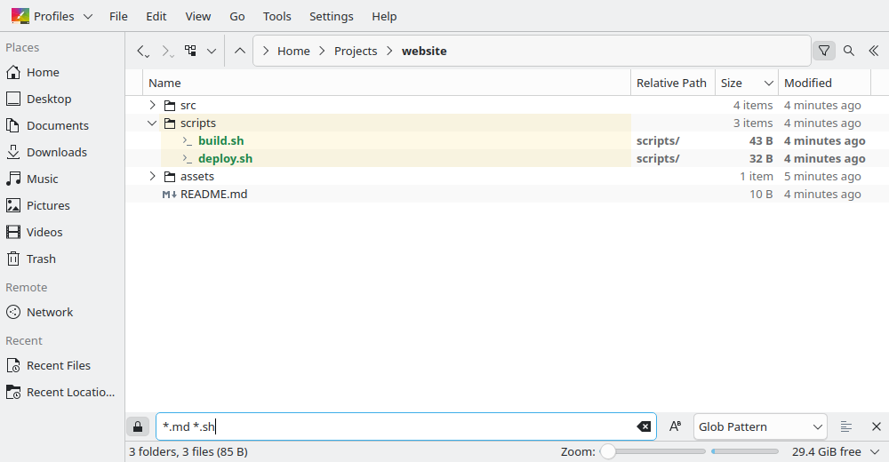

# The Little Things

## Nothing spectacular, but well worth having

Not every improvement has to be revolutionary. Often, it's the little things that make the biggest difference in everyday use.

When you perform a particular action a hundred times a day, saving just one mouse click can make a significant difference. And sometimes, it's simply about making things look a little nicer or wasting less space.

Orcinus deliberately pays close attention to these little things. Some of them you may not fully appreciate until you find yourself using another file manager again.

Here is our collection. Not exhaustive, but plenty of saved clicks.

## The filter stays put

In Dolphin, the filter is cleared every time you change folders. You filter for `*.jpg`, go one folder down, and everything is back. In Orcinus, **Keep Filter When Changing Folders** is switched on by default, and it's remembered too. If you want to get rid of the filter, just close the filter bar. That clears the text.

## Folders stay visible

A new button in the filter bar decides what the filter applies to:

- **Files (Folders Stay Shown):** the default. So `*.jpg` no longer hides all folders, and you can keep navigating.
- **Folders (Files Stay Shown)**
- **Files and Folders:** Dolphin's behavior.

## Several patterns at once

In **Glob Pattern** mode you can enter several patterns, separated by spaces, commas or semicolons: `*.jpg *.png *.webp`. An item is shown if it matches one of the patterns. You can roughly cover spaces inside a file name with the `?` wildcard.

## Recent folders

*File → Recent Folders* lists the folders you've been in recently, from all windows. One click takes you back there. *Clear List* at the end tidies up. If you need the menu more often, put it into the toolbar as a button via *Configure Toolbars…*. Search results don't end up in the list, by the way.

## Shift+double-click: just open it

**Shift+double-click** (or **Shift+Enter**) is your "just do what I mean" shortcut:

- For an image or video, the built-in viewer is skipped, and the file opens in its application.
- A script is always run in a terminal that stays open afterwards, no matter what the settings say. That way you also see what it printed.

## Running scripts in a terminal

Speaking of scripts: in *Settings → Configure Orcinus… → Interface → Confirmations → When opening an executable file* there are four more options next to Dolphin's *Always ask*, *Open in application* and *Run script*:

- **Run script in terminal:** the terminal stays open until you press Enter.
- **Run script in terminal and close:** the terminal closes when the script ends, unless the script ends with an error code.
- **Run script in minimized terminal**
- **Run script in minimized terminal and close**

The terminal starts in the script's folder. If something goes wrong, it stays open, and a minimized terminal comes to the front so you don't miss the error message.

## Dragging from anywhere on the row

In Dolphin's Details view, dragging in the empty part of an unselected row starts a rubber band selection, not drag and drop. If you like to quickly drag a file somewhere, you regularly grab thin air.

With *View → Details → Dragging: Drag files and folders from anywhere on the row* you drag the item instead. If you need a rubber band after all, hold *Shift* while dragging. The option is off by default because it changes familiar behavior.

## Following symbolic links

*Interface → Folders & Tabs → Always follow symbolic links to their target* (off by default): if you open a folder through a symbolic link, Orcinus shows it at its real location. The location bar then shows the target path instead of the link's path. Good when you want to know where you *really* are.

## USB sticks without the Christmas tree effect

FAT, NTFS and exFAT don't know an executable bit. That's why many systems mount them so that simply *every* file counts as executable. If you copied something from there to your disk, in Dolphin every vacation photo suddenly became a "program".

Orcinus removes this false bit again after copying or moving. Real programs are exempt (ELF files and scripts starting with `#!`). This applies to copy, cut and paste, drag and drop, and *Copy to Other View* / *Move to Other View*. Only the *Copy To* / *Move To* submenus in the context menu go through KIO and aren't covered.

## And even more space

Two settings that are really too big for this chapter, but fit "wasting less space" so well that they have to be mentioned here at least:

- **Bar density** makes the bars around the file views flatter (see the chapter "Toolbars").
- **Information density** moves the files in the views closer together (see the chapter "Views").

Both are already set to *Compact* for new users. If you like it even denser: *Very compact*. Your screen will be amazed at how much fits on it.
