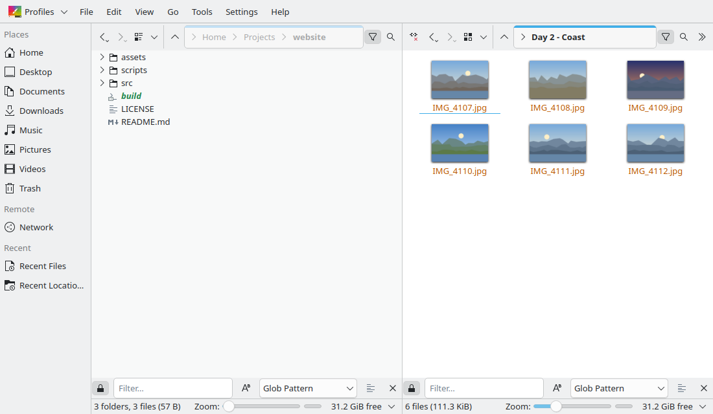
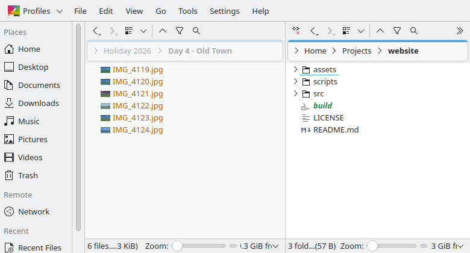
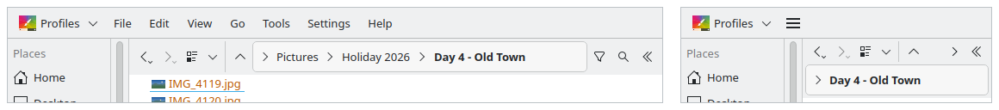
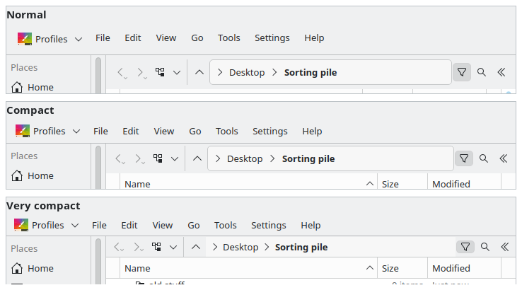

# Toolbars

## A toolbar for every view

Dolphin has one toolbar for the whole window. That's nice and tidy as long as you only have one view open. But as soon as you split the view, the guessing game begins: which half does the Back button act on now? And why does the hidden files button say "on" when there are none to be seen on the left?

Orcinus does it differently: **every file view can get its own toolbar**, right above the view. In a split view that means two of them, one per half. (You can also keep or bring back Dolphin's way with just one toolbar, if you prefer that.)

The buttons on such a toolbar only act on their own view and only show its state: Back and Forward (with their history menus), Up, Reload, the location bar, view mode, zoom, sorting, previews, hidden files, Filter and Search. Clicking a button makes its view the active one right away. So the next keyboard shortcut lands exactly where you just clicked.

The keyboard shortcuts themselves stay global, by the way, and act on the active view, just like in Dolphin.

### Configuring and hiding

- In *Settings → Configure Toolbars…* you'll find the *File View Toolbar* next to the *Main Toolbar*. All file views share the same layout, so you don't have to set up each half separately.
- *View → Show File View Toolbars* shows or hides all of them, in all windows and tabs. The toolbars' context menu also has *Hide File View Toolbars*.

So that you don't lock yourself out: while the toolbars are hidden, you'll also find the profiles in the menu button and in the context menu of the view background. There's always a way back.

### The main toolbar

Since navigation now lives in the file views, the main toolbar is nice and short for new users: Profiles, the menu bar and the menu button. That's it. If you had already set up your toolbar before, it stays exactly the way it is, of course.

## A location bar per view

It follows logically: every view also has **its own location bar**. It sits in the file view toolbar, by default right after "Up".

When a view gets narrow, the location bar doesn't disappear into the toolbar's overflow menu (where nobody would ever find it again) but moves to a **second row**. And since it would look rather restless if the file lists then started at different heights, all views of a tab do this together.

The location bar is a perfectly normal toolbar element. So you can move it around or remove it altogether.

## The split buttons

At the right end of the toolbar there's a small but useful button:

- With only one view open, it shows **`<<`**. One click opens the split view.
- With two views open, the end of the right toolbar shows **`>>`**. One click closes the right view, no matter what the settings for closing the split view say.

But the `>>` button can do more: **right-click** it for *Split View To Tabs* (both halves become tabs of their own) and *Pop out Right View* (the right half moves to a window of its own).

And the search button of a toolbar opens the search bar of exactly that view, not just any one.

## The menu bar as an element

The classic menu bar is quite a space hog: a whole row of height for a handful of words. But you might not want to live entirely without a menu either.

That's why Orcinus has the **menu bar as a toolbar element**. You'll find it in *Configure Toolbars…* as *Menu Bar*; for new users it already sits in the main toolbar. It shows all menu titles side by side, but shares its row with other buttons. And when space runs short, it turns into a menu button (the "burger" ☰).

The classic menu bar is still there, of course. *Ctrl+M* shows and hides it as usual, independently of the element.

## Bar density: slimming down the bars

The bars around the file views are padded quite generously in Dolphin. That looks airy, but costs space, and you'd rather have that space for your files.

In *Settings → Configure Orcinus… → Interface → Status & Location bars → Bar density* you can make the bars flatter. This applies to the window's toolbars, the file view toolbars including their location bars, the filter bar and the status bar:

- **Normal:** Dolphin's look.
- **Compact:** smaller margins and buttons. Text fields keep their height and frame. This is the default for new users. The two bars at the top then need about 78 instead of 94 pixels.
- **Very compact:** text fields and drop-down lists get flatter too and lose their frame. The two top bars then get by with about 61 pixels, the status bar with 20 instead of 30. Thin lines separate the file view from its toolbar and the filter bar.

The change takes effect immediately. Dialogs, menus and the views themselves stay as they are. The views have a setting of their own, the *information density* (see the chapter "Views"). You set the icon size as usual in the context menu of the respective toolbar.
