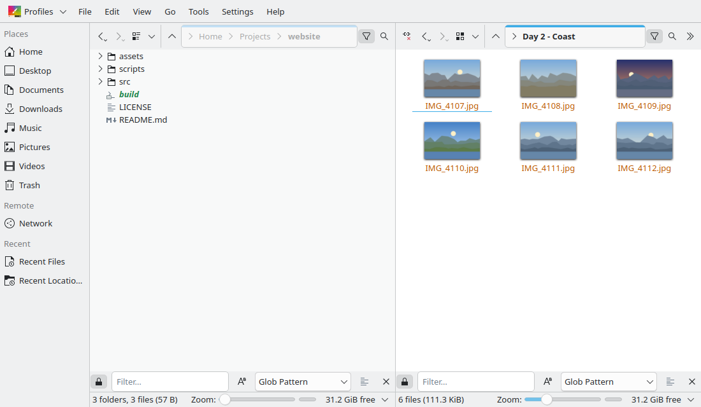
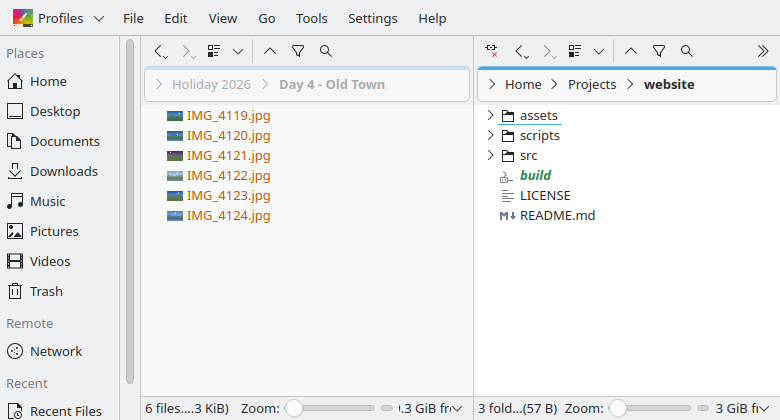
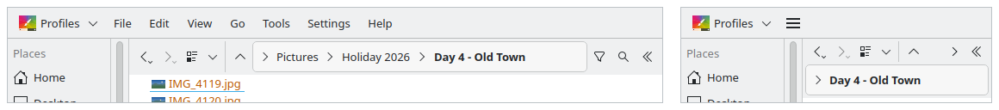
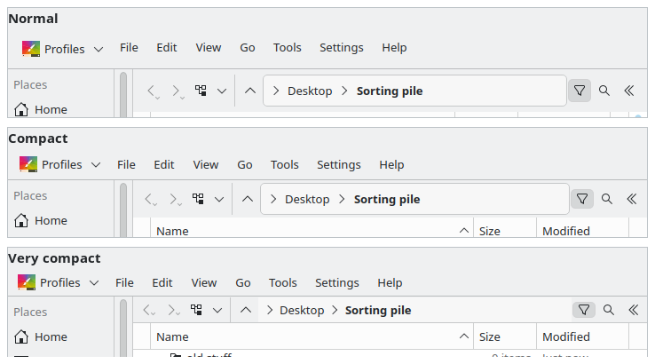

# Werkzeugleisten

## Jeder Ansicht ihre eigene Leiste

In Dolphin gibt es eine Werkzeugleiste für das ganze Fenster. Das ist übersichtlich, solange Du nur eine Ansicht offen hast. Sobald Du aber die Ansicht teilst, fängt das Rätselraten an: Auf welche Hälfte wirkt jetzt der Zurück-Knopf? Und warum zeigt der Knopf für versteckte Dateien gerade „an“, obwohl links gar keine zu sehen sind?

Orcinus macht es anders: **Jede Dateiansicht kann ihre eigene Werkzeugleiste bekommen**, direkt über der Ansicht. In einer geteilten Ansicht also zwei Stück, eine pro Hälfte. (Es ist aber auch möglich, die Dolphin-Vorgehensweise mit nur einer Werkzeugleiste beizubehalten bzw. wiederherzustellen, falls Dir das besser gefällt.)

Die Knöpfe einer solchen Leiste wirken nur auf ihre eigene Ansicht und zeigen auch nur deren Zustand: Zurück und Vor (mit ihren Verlaufsmenüs), Hoch, Neu laden, Adressleiste, Ansichtsmodus, Zoom, Sortierung, Vorschauen, versteckte Dateien, Filter und Suche. Klickst Du auf einen Knopf, wird seine Ansicht gleich zur aktiven. Das nächste Tastenkürzel landet also dort, wo Du gerade hingeklickt hast.

Die Tastenkürzel selbst bleiben übrigens global und wirken, wie in Dolphin, auf die aktive Ansicht.

### Einrichten und verstecken

- Unter *Einstellungen → Werkzeugleisten einrichten …* findest Du neben der *Haupt-Werkzeugleiste* auch die *Werkzeugleiste der Dateiansicht*. Alle Dateiansichten teilen sich dasselbe Layout. Du musst also nicht jede Hälfte einzeln einrichten.
- *Ansicht → Werkzeugleisten der Dateiansichten anzeigen* blendet sie alle ein oder aus, in allen Fenstern und Unterfenstern. Im Kontextmenü der Leisten gibt es außerdem *Werkzeugleisten der Dateiansichten ausblenden*.

Damit Du Dich nicht aussperrst: Wenn die Leisten ausgeblendet sind, findest Du die Profile auch im Menüknopf und im Kontextmenü des Ansichtshintergrunds. Ein Weg zurück ist also immer da.

### Die Hauptwerkzeugleiste

Weil die Navigation jetzt in den Dateiansichten sitzt, ist die Hauptwerkzeugleiste für neue Benutzer schön kurz: Profile, die Menüleiste und der Menüknopf. Das war's. Hast Du Deine Werkzeugleiste schon vorher eingerichtet, bleibt sie natürlich so, wie sie ist.

## Eine Adressleiste pro Ansicht

Logische Folge: Jede Ansicht hat auch ihre **eigene Adressleiste**. Sie sitzt in der Werkzeugleiste der Dateiansicht, standardmäßig gleich hinter „Hoch“.

Wird eine Ansicht schmal, verschwindet die Adressleiste nicht im Überlaufmenü der Werkzeugleiste (wo sie niemand mehr findet), sondern rutscht in eine **zweite Zeile**. Und weil es ziemlich unruhig aussehen würde, wenn die Dateilisten dann auf unterschiedlicher Höhe anfangen, machen das alle Ansichten eines Unterfensters gemeinsam.

Die Adressleiste ist ein ganz normales Element der Werkzeugleiste. Du kannst sie also verschieben oder auch ganz entfernen.

## Die Teilen-Knöpfe

Am rechten Ende der Werkzeugleiste gibt es einen kleinen, aber feinen Knopf:

- Ist nur eine Ansicht offen, steht dort **`<<`**. Ein Klick öffnet die geteilte Ansicht.
- Sind zwei Ansichten offen, steht am Ende der rechten Werkzeugleiste **`>>`**. Ein Klick schließt die rechte Ansicht, egal, was in den Einstellungen zum Schließen der geteilten Ansicht steht.

Der `>>`-Knopf kann aber noch mehr: Ein **Rechtsklick** darauf bietet *Geteilte Ansicht zu Unterfenstern* (beide Hälften werden zu eigenen Unterfenstern) und *Rechte Ansicht herauslösen* (die rechte Hälfte wandert in ein eigenes Fenster).

Und der Suchknopf einer Werkzeugleiste öffnet die Suchleiste genau dieser Ansicht, nicht irgendeiner.

## Die Menüleiste als Element

Die klassische Menüleiste ist ein ziemlicher Platzfresser: Eine ganze Zeile Höhe für ein paar Wörter. Ganz ohne Menü willst Du aber vielleicht auch nicht leben.

Orcinus hat deshalb die **Menüleiste als Element der Werkzeugleiste**. Du findest sie unter *Werkzeugleisten einrichten …* als *Menüleiste*, bei neuen Benutzern sitzt sie bereits in der Hauptwerkzeugleiste. Sie zeigt alle Menütitel nebeneinander, teilt sich die Zeile aber mit anderen Knöpfen. Und wenn der Platz knapp wird, verwandelt sie sich in einen Menüknopf (den „Burger“ ☰).

Die klassische Menüleiste gibt es natürlich trotzdem noch. *Strg+M* blendet sie wie gewohnt ein und aus, unabhängig vom Element.

## Leistendichte: Abspecken für Leisten

Die Leisten rund um die Dateiansichten sind in Dolphin recht großzügig gepolstert. Das sieht luftig aus, kostet aber Platz, und den willst Du lieber für Deine Dateien haben.

Unter *Einstellungen → Orcinus einrichten … → Benutzeroberfläche → Status- & Adressleisten → Leistendichte* kannst Du die Leisten flacher machen. Das gilt für die Werkzeugleisten des Fensters, die Werkzeugleisten der Dateiansichten samt Adressleisten, die Filterleiste und die Statusleiste:

- **Normal:** Dolphins Aussehen.
- **Kompakt:** kleinere Ränder und Knöpfe. Textfelder behalten Höhe und Rahmen. Das ist die Voreinstellung für neue Benutzer. Die beiden Leisten oben brauchen damit etwa 78 statt 94 Pixel.
- **Sehr kompakt:** auch Textfelder und Auswahllisten werden flacher und verlieren ihren Rahmen. Die beiden oberen Leisten kommen dann mit etwa 61 Pixeln aus, die Statusleiste mit 20 statt 30. Dünne Linien trennen die Dateiansicht von ihrer Werkzeugleiste und der Filterleiste.

Die Änderung wirkt sofort. Dialoge, Menüs und die Ansichten selbst bleiben, wie sie sind. Für die Ansichten gibt es eine eigene Einstellung, die *Informationsdichte* (siehe Kapitel „Ansichten“). Die Symbolgröße stellst Du wie gewohnt im Kontextmenü der jeweiligen Werkzeugleiste ein.
