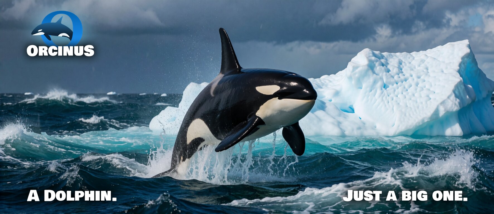
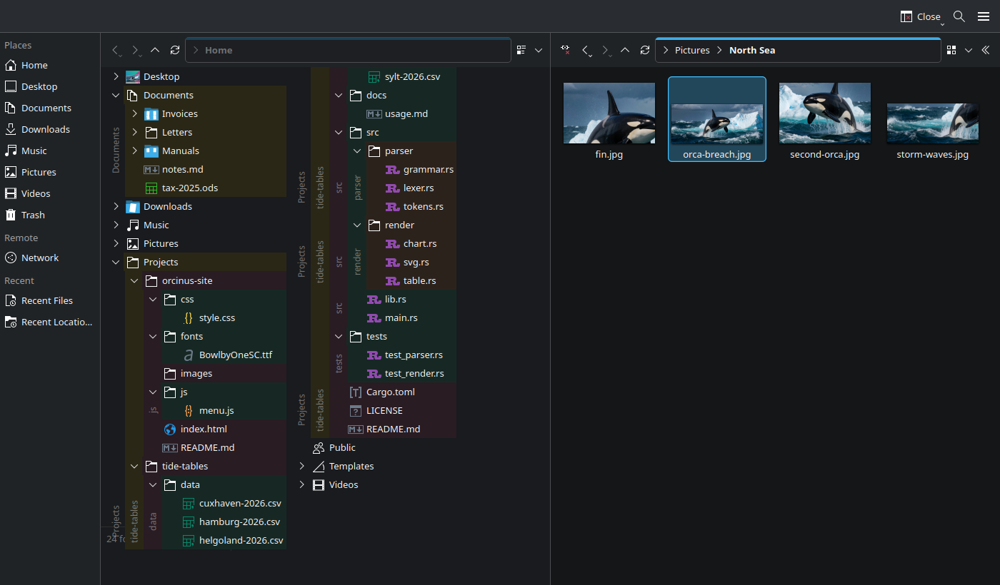
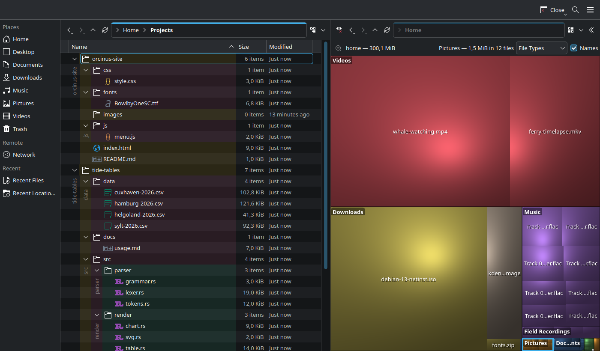

# Orcinus

*Orcinus* is the genus of the orca, the largest member of the dolphin family. Orcinus is a
file manager based on KDE's Dolphin, made for power users who want more functionality and
more control, without giving up what makes Dolphin good. If you know Dolphin, you will feel
at home right away.

> Orcinus is an unofficial fork. It is not affiliated with, endorsed by, or
> supported by KDE e.V. or the Dolphin developers. Please report problems with
> Orcinus to the Orcinus issue tracker, not to KDE. KDE® is a registered
> trademark of KDE e.V.

**Status: alpha (0.1.0).** Orcinus is used every day by its developer, but rough edges remain,
and until 1.0 settings and internals may still change (settings are migrated where possible).

## What Orcinus adds

- **A toolbar and a location bar for every view**, so each half of a split view has its own
  Back, Forward, view mode and location.
- **Split views that keep their own display style**, can be linked (both views follow the same
  folder and selection), and can be moved to a tab or a window of their own.
- **Profiles**: switch the whole look of a window (views, toolbars, panels, …) with one
  shortcut.
- **A built-in image and video viewer** that keeps the view's selection on the file you are
  looking at.
- **Cushion Treemap**: see at a glance what takes up the space below a folder.
- **Show flat**: the files of all subfolders in one list.
- **Expandable folders in the Compact view**, with colored backgrounds and names that show
  where each folder's contents start and end.
- **File name highlighting** by rules, a filter that keeps its text and leaves folders alone,
  scripts that run in a terminal, and more.





All differences, with their settings and defaults:
[docs/orcinus-vs-dolphin.md](docs/orcinus-vs-dolphin.md). Changes per version:
[CHANGELOG.md](CHANGELOG.md). Everything else works as described in the
[Dolphin Handbook](https://docs.kde.org/?application=dolphin).

## Installing

Orcinus installs next to Dolphin and does not change it: it has its own executable
(`orcinus`), configuration and application entry. It does not need a Dolphin package; Dolphin's
version control plugins (`dolphin-plugins`) and service menus are used when they are installed.

**Ubuntu 26.04 and 26.10**:

```bash
sudo add-apt-repository ppa:arkarit/orcinus
sudo apt install orcinus
```

**Arch Linux** (AUR): [`orcinus`](https://aur.archlinux.org/packages/orcinus) for the release,
[`orcinus-git`](https://aur.archlinux.org/packages/orcinus-git) for the development version,
e.g. `yay -S orcinus`.

**Other distributions**: build from source (below). Orcinus needs KDE Frameworks 6.23 or newer.

To use Orcinus for opening folders from other applications, choose it in *System Settings →
Default Applications → File Manager*. "Show in folder" from browsers still opens Dolphin in
this release.

## Building from source

You need Qt 6, KDE Frameworks 6 and Extra CMake Modules; libmpv is optional (videos in the
built-in viewer). Use a build and install prefix separate from any Dolphin build:

```bash
cmake -S . -B ../build-orcinus -G Ninja \
    -DCMAKE_BUILD_TYPE=RelWithDebInfo \
    -DBUILD_TESTING=ON \
    -DCMAKE_INSTALL_PREFIX="$PWD/../install-orcinus"
cmake --build ../build-orcinus
ctest --test-dir ../build-orcinus --output-on-failure
../build-orcinus/bin/orcinus --new-window
```

Orcinus installs its private libraries into `lib/<arch>/orcinus/`, among them a private copy of
Dolphin's small version control library (`libdolphinvcs.so.6`), so the plugins of
`dolphin-plugins` work. The view plugin API (`liborcinusviewapi`) is internal for now; there is
no stable interface for third-party plugins yet. The defaults do not claim
`org.freedesktop.FileManager1` and do not install Dolphin's KPart, KCMs, service menus or
handbook; `-DWHALE_PROVIDE_FILEMANAGER1=ON` enables the FileManager1 integration. Without a
matching Baloo Widgets package the Information panel is disabled, but Orcinus still builds.

Orcinus was developed under the working title Whale. Source directories, class names, CMake
variables and action names still use that name; everything installed or shown to users says
Orcinus.

## Development philosophy

Orcinus follows one guiding principle:

**Make the common case simple and excellent. Make the uncommon case possible.**

Frequently used features should be simple, intuitive and exceptionally well done. More
specialized needs should meet as few artificial limits as possible. The goal is not to cram in
as many features as possible, but a file manager that stays practical, tidy and enjoyable to
use, also for demanding work.

Dolphin is designed for a broad range of users; Orcinus is aimed at power users. Dolphin's
rule for getting there still applies: a feature must be **non-intrusive**. It must not clutter
the main menu, context menus or toolbars for people who do not need it. A new behavior that
changes something existing users rely on is off by default, and their settings are kept. New
users start with Orcinus' own defaults, chosen for its audience; they are listed in
[the differences to Dolphin](docs/orcinus-vs-dolphin.md#10-defaults-for-new-users).
[Dolphin's development philosophy](https://invent.kde.org/system/dolphin/-/blob/master/README.md#development-philosophy)
describes its target users and this rule in detail.

Orcinus stays close to Dolphin: Dolphin's development is merged regularly, and fixes that also
apply to Dolphin are kept small so they can be offered upstream.

## Contributing

See [CONTRIBUTING.md](CONTRIBUTING.md). In short: problems and ideas for Orcinus go to the
[Orcinus issue tracker](https://github.com/Arkarit/orcinus/issues). Problems that also happen in
an unmodified Dolphin belong to KDE: see [KDE Invent](https://invent.kde.org/system/dolphin) and
the [KDE Bugtracking System](https://bugs.kde.org/enter_bug.cgi?format=guided&product=dolphin).
Security issues: see [SECURITY.md](SECURITY.md).

Orcinus is developed with the help of AI, and contributions made partly or entirely with AI are
welcome. What counts is what a contribution delivers, not how it was made; every contribution
gets the same careful review.

## License

Orcinus is licensed like Dolphin, mainly under the GPL 2.0 or later; see the SPDX headers and
`LICENSES/`. Dolphin's copyright holders and history are kept.
