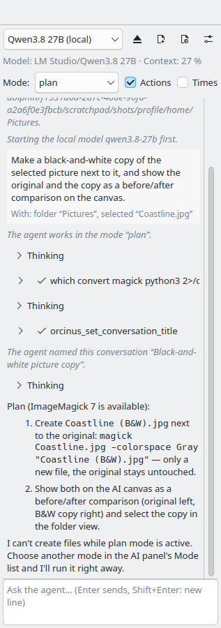
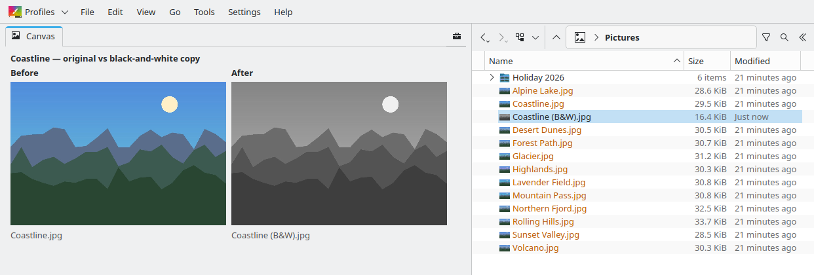

// SPDX-FileCopyrightText: 2026 Orcinus contributors
// SPDX-License-Identifier: GPL-2.0-or-later
//
// Source: .privatedoc/orcinus-handbook-raw/AISupport.md (German: KI-Unterstuetzung.md)

[#orcinus-ai-support]
== AI Support

[#ai-intro]
=== An assistant in the file manager

"Give these 300 photos sensible names." "Why is my home folder so big?" "Build me a tool for sorting out photos quickly." An AI agent can take care of things like these for you, and Orcinus gives it a place right next to your files.

To do this, Orcinus talks to an *AI agent running on your computer*, for example Claude Code, Codex or OpenCode with a local model. You type in a panel. The agent sees which folder you have open and what you've selected, and it can open folders, select files and operate Orcinus for you.

Orcinus itself calls *no AI service*. Login, model, billing and the agent's tools remain the agent's business. Out of the box nothing is set up, and nothing leaves your computer before you add an agent yourself.

How to set up an agent is described in the chapter <<orcinus-ai-agents,Setting up AI Agents>>.

[#ai-serious-word]
=== Before you start: a serious word

This is where the fun stops for a moment. An agent works *with your permissions*. It can read, change and delete your files, start programs and, if you allow it, ask for administrator rights. Orcinus has no sandbox of its own.

* If AI agents are new to you, try them out in a *virtual machine* first.
* Make *backups* of everything that matters to you.
* If you don't understand what the agent is about to do: *ask it* before you allow it.
* If you use a cloud agent, the contents the agent reads (files, command output, paths) go to the provider's servers. Be aware of that.

When you open the panel for the first time, a dialog explains exactly this. Only after you've confirmed it does the panel work.

[#ai-panel]
=== The "AI Assistant" panel

You open it with *F8* or via _View → Panels → AI Assistant_. At the top you choose the agent, start a new conversation, open a saved one or jump to the settings (_Settings → Configure Orcinus… → AI Support_).

.The "AI Assistant" panel

[#ai-modes]
==== Modes and permissions

A freshly set-up agent starts in its *most cautious mode*, such as _Plan_ or _Read only_. So it may look around, but it asks before it changes anything. You loosen this with the _Mode_ field below the agent's name. The mode you choose there also applies the next time you start.

If the agent wants to do something its mode doesn't allow, *it asks in the conversation*, and you answer there. If a question is waiting, the panel opens by itself so the agent isn't left twiddling its thumbs forever.

[#ai-context]
==== What the agent sees

With every message, the agent gets the folder of the active view, the selected items and the folder of the other half of the split view. The line below your message shows what was sent along. Files you drag onto the input field, copied files and pasted images go along as small "chips".

[#ai-actions]
==== What the agent can do in Orcinus

It can open folders, select files, change the view mode, split the view, change a number of settings and profiles and trigger most actions from the menus. Each of these actions shows up as a line in the conversation. The _Actions_ checkbox hides them.

[#ai-limits]
===== Limits

Orcinus gives the agent no function for changing its own AI settings. At most it can suggest a new agent, which you then add yourself. An agent could get around that through the file system, though. So: always stay alert.

[#ai-no-undo]
===== No undo for the agent

Orcinus can't undo what an agent does. It can start programs outside Orcinus, change or delete files and mess with system settings. That's beyond Orcinus' control. When in doubt, make a backup first, or ask the agent to make one.

[#ai-commands]
==== Commands

A message starting with `+/+` is a command and goes straight to the agent, for example `+/usage+` with Claude (shows the 5-hour and weekly limits) or `+/status+` with Codex. If you type just `+/+`, Orcinus lists all commands from Orcinus and from the agent.

[#ai-usage]
==== Usage

The line below the agent's name shows the model and how full the context is. Its tooltip lists the conversation's tokens and, if the agent reports them, the costs. With a subscription, these are the costs the same usage would cause through the API. Good to know, but no reason to panic.

[#ai-suggestions]
==== Suggestions

A new conversation offers you a few suggestions to get started: rename files, check the system, report a problem with Orcinus, and so on. A click puts the text into the input field, where you can add to it. Nothing is sent until you press Enter.

[#ai-admin]
==== Administrator rights

If it's allowed (_AI Support → Agents → Administrator rights → Let agents ask for administrator rights_, on by default), the agent may run individual commands as administrator via `+pkexec+`. The system then asks for your password *every single time*. Read carefully beforehand what is about to be run.

[#ai-memory]
=== Conversations and memory

* *Saving conversations* (_AI Support → Memory → Conversations_, on by default, for 90 days): the _Saved Conversations_ button lists them. An agent that supports it continues a saved conversation exactly where it left off. In the same menu you can *export* the displayed conversation as PDF, Markdown or text.
* *Language:* the agents answer in Orcinus' language or in the one you set in _Talk with agents in_.
* *Memory:* short notes the agent gets in every conversation, for all folders or for one folder and its subfolders. For example: "Invoices go into one folder per year, PDFs keep their names."
** _Manual_ (default): the agent proposes a note, and you keep or discard it.
** _Automatic_: the agent remembers things by itself.
** _Off_.

+
You can write a note yourself with `+/remember …+` (for the displayed folder) or `+/remember global …+`. The notes apply to all agents and are separate from their own memory.
* *System prompt* (_AI Support → System Prompt_): this is what Orcinus tells every agent at the start. You can replace it with your own text.

[#ai-local-models]
=== Local models

Agents like OpenCode can also work with a *model on your own graphics card* instead of a cloud service. Then nothing leaves your computer (as long as your setup itself doesn't pass on any data), and there's no bill either. Well, except for the electricity bill. And the installments for the graphics card, which can cost anything from a few hundred euros to five figures. But nothing else, promise. You need a card with enough memory for this (with 16 GB you can already do quite a bit, especially with Strata), and a local model is usually slower and less capable than the big cloud models.

Orcinus finds the models of *LM Studio* and *Strata*: _AI Support → Agents → Add… → Local Model (LM Studio)…_ (or _(Strata)_) creates an agent for one of them.

Orcinus starts the model server when a conversation needs it and unloads the model again when the conversation ends or the panel stays hidden for a while. That way it doesn't block the graphics memory permanently, and your after-work game doesn't stutter. With the button next to the agent you load or unload the model by hand.

[#ai-canvas]
=== The AI Canvas and its tools

_View → Panels → AI Canvas_ is where the agent shows its work: images and videos it has generated, files it has found, sounds, texts and before-and-after comparisons. Clicking an item shows the file in the view.

.The AI Canvas with a before-and-after comparison

If you ask, the agent also builds small *tools* for the canvas: a window of its own with buttons, lists and previews (Qt Quick), optionally with a Python program behind it. For example: "Go through the photos in this folder and let me keep or discard each one." A tool opens as a tab of the canvas. With _Keep on Canvas_ it's still there the next time you start.

The Tools button lists your tools and offers *example tools* (_Add Example Tool_, such as _Photo Triage_ for sorting out photos).

Tools run with your permissions, just like the agent. That's why the program of a tool you haven't kept yet only starts after you've confirmed it.

[#ai-workbench]
=== The AI Workbench

If you want to use the assistant and the canvas together, just take the profile *AI Workbench*: the canvas on the left, the Details view in the middle, the assistant on the right. Everything you need at a glance. Since three areas side by side need a lot of room, we recommend at least Full HD (1920 × 1080) for it.
