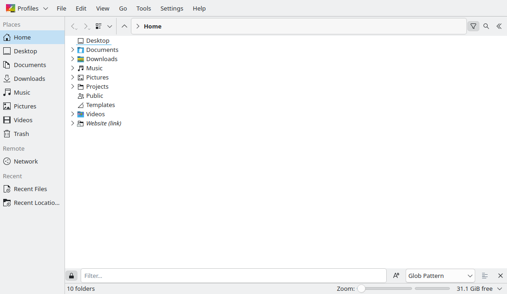

// SPDX-FileCopyrightText: 2026 Orcinus contributors
// SPDX-License-Identifier: GPL-2.0-or-later
//
// Source: .privatedoc/orcinus-handbook-raw/DolphinAndOrcinus.md (German: GenerelleUnterschiede.md)

[#orcinus-and-dolphin]
== Dolphin and Orcinus Side by Side

[#together-shared-habitat]
=== The shared habitat

Our goal was for Dolphin and Orcinus to coexist peacefully. After all, dolphins and orcas swim in the same sea without constantly biting each other's fins.

That's why Dolphin and Orcinus share some resources, while others stay separate.

[#together-own]
==== What Orcinus keeps to itself

* *Its own identity:* Orcinus has its own app ID (`+io.github.arkarit.orcinus+`), its own executable (`+orcinus+`), its own D-Bus names, its own icon and its own entry in the task manager. Start `+dolphin+` and you get Dolphin. Start `+orcinus+` and you get Orcinus. No danger of mixing them up.
* *Its own configuration:* Orcinus stores its settings in `+orcinusrc+` (and a few sibling files). Dolphin's configuration `+dolphinrc+` is neither read nor written. Toolbars, keyboard shortcuts and sessions are separate too. So you can rebuild Orcinus to your heart's content, and your Dolphin stays completely unimpressed.

[#together-shared]
==== What both of them share

These are shared on purpose (and, by the way, with other KDE applications as well):

* the *Places* in the side panel,
* the *Trash*,
* the *bookmarks*,
* the *service menus* (the entries under "Actions" in the context menu),
* the *"Create New" templates*,
* the desktop search *Baloo*,
* the *thumbnail cache* (previews Dolphin has already generated don't have to be computed again by Orcinus),
* the *display style saved for individual folders*.

Orcinus also uses Dolphin's version control plugins (from the `+dolphin-plugins+` package, e.g. for Git), its service menus and the first part of its handbook, if they are installed. Dolphin itself doesn't need to be installed for that.

[#together-default-file-manager]
==== Orcinus as your default file manager

If you like Orcinus so much that you want to use it for everything: in _System Settings → Default Applications → File manager_ you can set Orcinus as your default file manager. Folders opened from other applications will then open in Orcinus.

There is one exception (for now): "Show in folder" from your browser and other applications goes through a separate interface (`+org.freedesktop.FileManager1+`), and in this version that stays with Dolphin. So don't be surprised if a dolphin suddenly pops up after a download.

[#together-crashes]
==== When things go bang

Crashes happen in the best of families. If you send a crash report, it goes to the Orcinus issue tracker, not to the Dolphin developers at bugs.kde.org. After all, our bugs are not their fault.

By the way, _Help → About Orcinus_ also shows which Dolphin version your Orcinus is based on. The _Authors_ tab lists the Orcinus authors first, followed by the Dolphin developers on whose fins we stand.

[#together-defaults]
=== Freshly moved in: the defaults

When you start Orcinus for the very first time, you don't get Dolphin's defaults but our own. We think they suit power users better:

.Orcinus on its very first start

* The *main toolbar* is short: Profiles, the menu bar as an element and the menu button. The navigation buttons live in the file view toolbars instead (more on that in the chapter <<orcinus-toolbars,Toolbars>>).
* Every file view has *its own toolbar* with Back, Forward, view settings, Up, the location bar, Filter and Search.
* There are *seven ready-made profiles*; _Compact_ is active on the first start.
* *File name highlighting* is switched on.
* The *filter bar* is visible in new windows (only on the very first start does the profile _Compact_ hide it).
* The *status bar* spans the full width of the window and has the zoom slider.
* Previews in the Compact view are 16 pixels in size.
* *Information density* and *bar density* are set to _Compact_. So more fits on your screen.

And if you've been using Orcinus for a while already? Then everything stays the way it was. New features that would change something you're used to are switched off by default for you. We don't touch your settings or your toolbars. If you're curious, just switch them on yourself.
