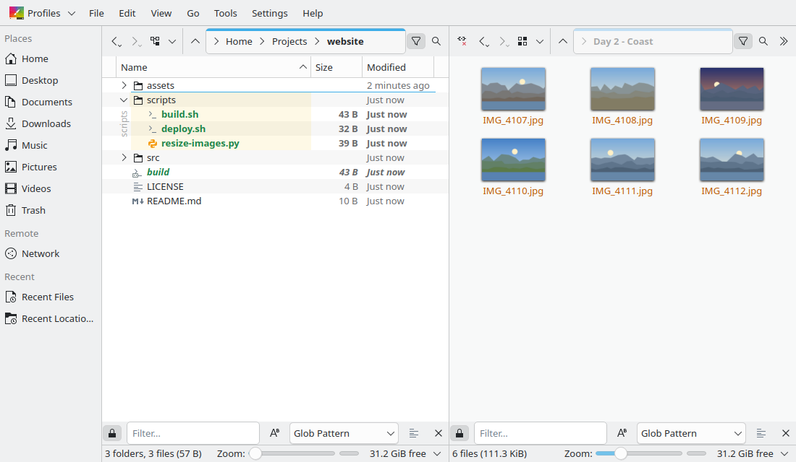
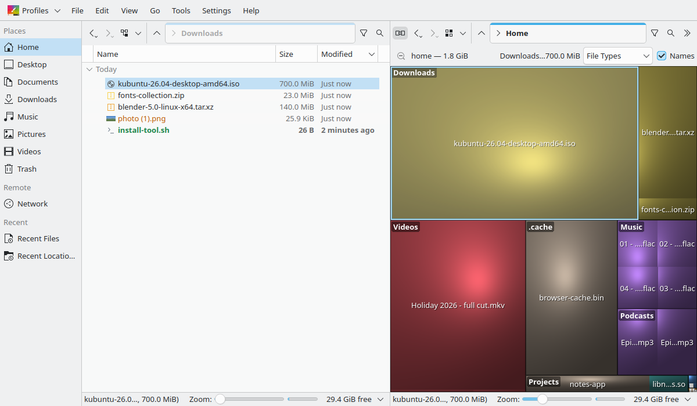

// SPDX-FileCopyrightText: 2026 Orcinus contributors
// SPDX-License-Identifier: GPL-2.0-or-later
//
// Source: .privatedoc/orcinus-handbook-raw/SplitView.md (German: GeteilteAnsicht.md)

[#orcinus-split-view]
== Split View

[#split-intro]
=== Two halves, two opinions

You already know the split view (_F3_) from Dolphin: one folder on the left, another on the right, and files flying back and forth in between. Orcinus builds on that and lets each half be a little more itself.

[#split-own-style]
==== Every view keeps its display style

In Dolphin, _Settings → Configure Dolphin… → View → General_ is set to _Use common display style for all folders_ by default. But there, "all folders" also means "both views": whichever view you changed last decides what the other one looks like in the next folder. And after a restart both look the same anyway. Details on the left, icons on the right? That lasts exactly until the next folder change.

In Orcinus, *every view keeps its own display style* (view mode, sorting, hidden files, previews, columns), even when it moves to another folder. Orcinus remembers this per side (left or right), and that's exactly how new windows, tabs and split views start as well.

.Details on the left, icons on the right – and it stays that way

A few places have a style of their own, such as the Trash, search, recent files and Downloads. They keep showing it, and when you leave them, the view gets its own style back.

If you pop out a view (_Pop out Right View_) or turn the halves into tabs (_Split View To Tabs_), it simply takes its style along.

And if you work with _Remember display style for each folder_, nothing changes compared to Dolphin.

[#split-startup]
==== Start split – or not

In _Interface → Folders & Tabs → Split new windows and tabs_ you decide whether new windows and tabs start split:

* *As last used* (default): the way you worked last.
* *Always*
* *Never*

This replaces Dolphin's checkbox "Open new windows in split view". If that was on for you, it becomes _Always_.

[#split-linked-views]
=== Linked views

Now it gets really exciting. At the left end of the right view's toolbar sits a button with a *chain link*. It links the two views to each other:

.Linked views: the ISO file is selected in the Cushion Treemap on the right, and the Details view on the left has followed it into the "Downloads" folder.

* *Same folder:* both views always show the same folder. When you link them, the right view takes over the location of the active one.
* *Mirrored selection:* whatever you select in one view is selected in the other as well.
* *Following along:* if the other view can't show the item in its place at all, for example because its folder isn't expanded there, it simply moves into that folder. When the selection comes back, it moves back too.

What's the point? Imagine you have a view on one side that shows the big picture (for example the <<orcinus-treemap,Cushion Treemap>> with the disk usage), and one on the other side that shows details. Click a fat rectangle in the treemap, and right next to it you immediately see which file it is, with size, date and everything. The ready-made profile _Locked Cushion Map_ does exactly that.

To keep the selection on both sides in sync, there are a few ground rules while the views are linked:

* You can only select several items *within one folder*. _Ctrl+click_ into another folder is refused, _Shift+click_ and the rubber band stay within the folder, and _Select All_ selects the folder of the current item. A short message explains this each time.
* You can only link *local folders*. If you go to FTP, SMB, the Trash or search results, the link is released with a message.

The link belongs to the tab and is off again after a restart. If you need it more often, just save it in a profile (see the chapter <<orcinus-profiles,Profiles>>).
