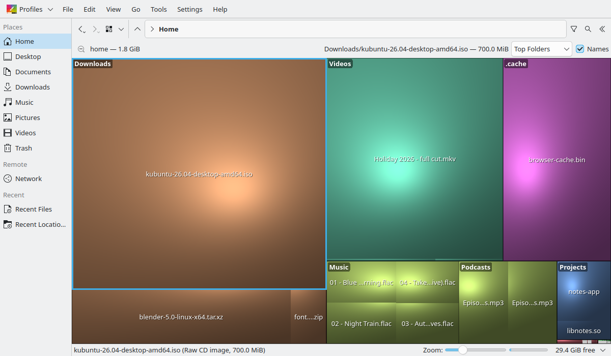
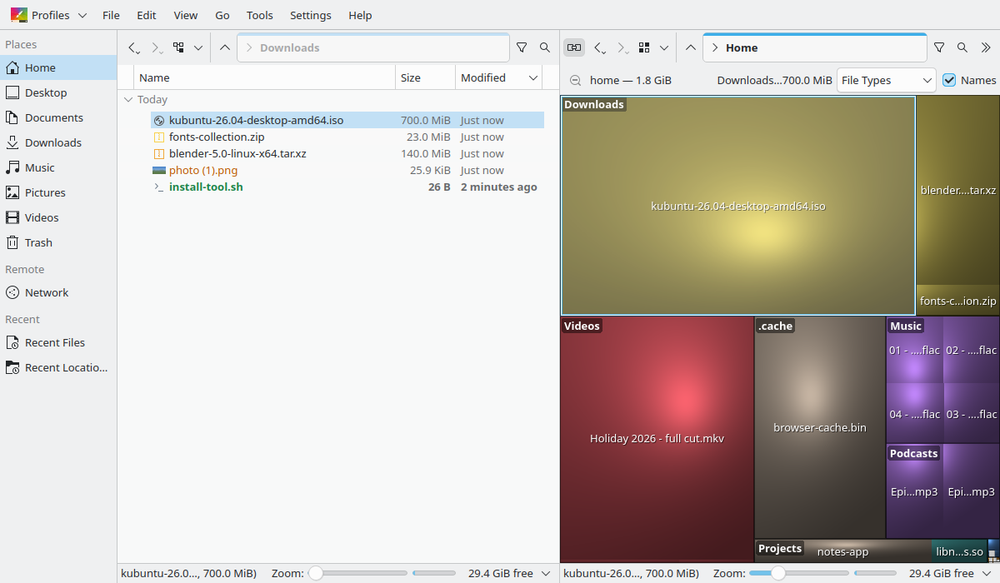

// SPDX-FileCopyrightText: 2026 Orcinus contributors
// SPDX-License-Identifier: GPL-2.0-or-later
//
// Source: .privatedoc/orcinus-handbook-raw/TheCushionTreemap.md (German: CushionTreemap.md)

[#orcinus-treemap]
== The Cushion Treemap

[#treemap-intro]
=== Where on earth did my disk space go?

The disk is full. Again. Somewhere a few gigabytes are lying around, but where? The classic answer is tools like Filelight, KDirStat or WinDirStat. Orcinus has something like that built right in: the *Cushion Treemap*.

.The Cushion Treemap of the home folder, colored by top folders. The ISO file in Downloads is the clear winner.

The treemap shows how the space below the current location is used. *Every file is a rectangle* whose area matches its size, and *folders are groups of rectangles*. The cushion shading makes the folder structure stand out in relief. Big files catch your eye immediately, and a folder full of odds and ends looks like a mosaic.

Hidden files always count, because they take up space too. Hidden caches in particular are often the worst offenders.

Like all other views, you'll find the treemap in the _View_ menu and in the view mode button.

[#treemap-colors]
=== Colors and names

Above the treemap sits a small bar of its own. On the left is a button to zoom out and next to it the path you've zoomed into. On the right you'll find information about the item under the mouse and the settings. In the drop-down list you choose what the colors are based on:

* *File Types:* images, videos, archives and so on each get their own colors. Ideal for seeing _what_ is eating the space.
* *Top Folders:* every folder directly below the current location gets a color. Ideal for seeing _where_ the space is being eaten.

With *Names*, Orcinus writes the file and folder names into the rectangles, as long as they fit.

[#treemap-usage]
=== Using it

* A *click* selects an item. A *double-click* or *Enter* opens a file or goes into a folder.
* The *arrow keys* jump to the neighbors and between the levels.
* The *mouse wheel* and **`{plus}`/`+−+`** zoom into the treemap without changing the location. Handy for taking a closer look at a folder without losing the big picture.
* Many small entries are combined into a *"…"* field. Clicking it selects their folder.

The selection works with all the usual actions: Copy, Cut, Move to Trash, Delete, Rename, Properties. The context menu also has _Show in Folder_ and _Show in Parent Folder_.

There's a safety line, too: in the treemap, the selection can lie deep in some subfolder where you can't see it directly. That's why _Move to Trash_, _Delete_ and _Cut_ *always* ask here and show the affected items, even if you've switched off KDE's confirmations.

[#treemap-linked]
=== The classic: treemap and Details linked

The treemap really shows its strengths in the *split, linked view* (see <<split-linked-views,Linked views>>): the Details view on the left, the treemap on the right. Click the suspiciously big rectangle on the right, and the file immediately shows up on the left with name, size and date. And vice versa.

The ready-made profile *Locked Cushion Map* sets this up for you with one click.

.The profile "Locked Cushion Map": one click on the ISO file in the treemap, and the Details view jumps into the "Downloads" folder.

[#treemap-limits]
=== Limits

* The treemap only scans *local folders* and stays on *one file system* while doing so. A network drive mounted below your home folder won't bloat the treemap.
* Since it shows files from many folders, nothing can be created, pasted or dropped in it. Like with the flat view, that only works in a normal view.
