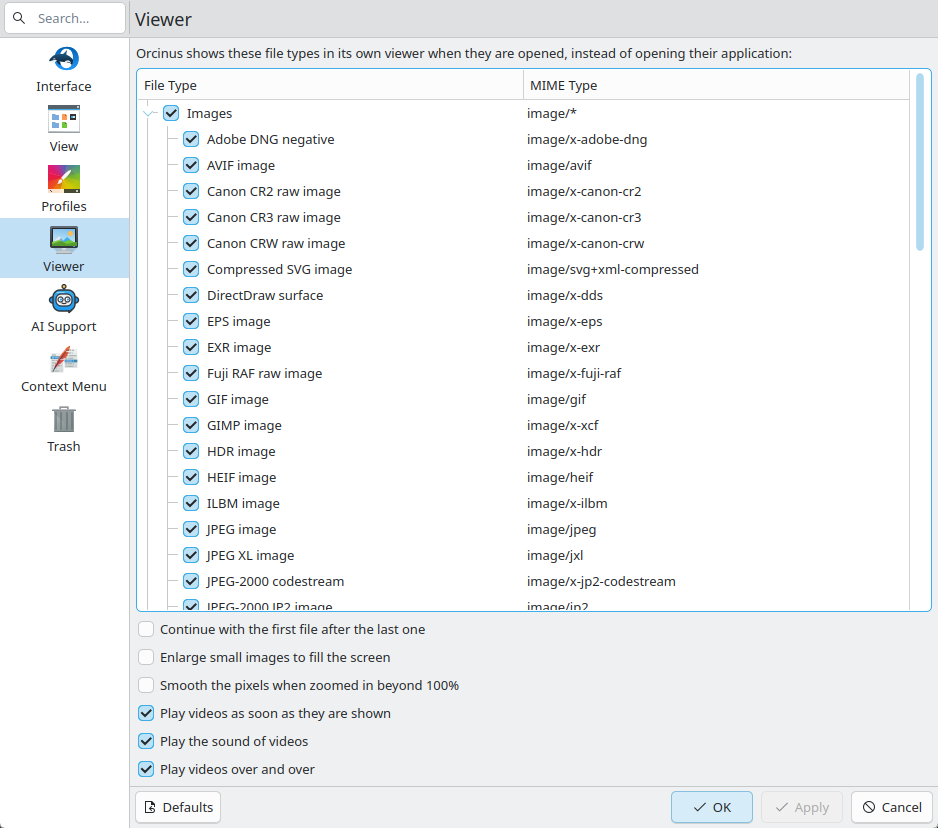

// SPDX-FileCopyrightText: 2026 Orcinus contributors
// SPDX-License-Identifier: GPL-2.0-or-later
//
// Source: .privatedoc/orcinus-handbook-raw/TheViewer.md (German: Betrachter.md)

[#orcinus-viewer]
== The Built-in Viewer

[#viewer-intro]
=== Looking at pictures without losing the thread

The classic routine: you double-click a photo, an image viewer opens, you flip through twenty pictures, find the right one, close the viewer and you're back in Orcinus at the first picture. Where was it again?

In Orcinus, an image or video opens in the *built-in full-screen viewer*. The special thing about it: *whatever the viewer shows is also the current and selected item in the view.* So when you press _Esc_, you're right at the file you looked at last. Ready to copy, move or delete.

.The built-in viewer

[#viewer-navigation]
=== Flipping through

You can flip through with

* the *mouse wheel*,
* the *arrow keys*,
* *Page Up* / *Page Down*,
* *Backspace* (back),
* *Home* / *End* (first / last picture),
* or a *click on the left or right edge of the screen*.

The viewer goes through the folder's viewable files in the order of the view, with its sorting and its filter. If you had several files selected when you opened it, it only flips through those. Handy if you just want to compare ten candidates.

[#viewer-images]
=== Images

* *Ctrl+mouse wheel* or **`{plus}`/`+-+`** zoom, up to 3200%. That shows you every single pixel. Really, every one.
* **`+1+`* shows the image at its original size (100%), *`+0+`** fits it to the screen.
* With the *middle mouse button* you move an enlarged section around.
* EXIF rotation and color profiles are respected. Animated GIFs and WebPs play.

[#viewer-videos]
=== Videos

The viewer plays videos too:

* *Space* or a *click* plays and pauses.
* *Left* / *Right* jumps 5 seconds back or forward.
* **`+M+`** mutes the sound.
* The controls appear as soon as you move the mouse and disappear again when you just want to watch in peace.

[#viewer-open-in-application]
=== The real application after all?

Sometimes you actually want to edit a picture. That's where *Shift+double-click* (or *Shift+Enter*) helps: the viewer is skipped, and the file opens in its normal application, for example GIMP or Gwenview.

[#viewer-settings]
=== Settings

On the page _Settings → Configure Orcinus… → Viewer_ you decide

* *which file types* the viewer opens (images and videos). Everything not checked here opens in its application as usual,
* whether it *starts over* at the end of the folder,
* whether *small images* are *enlarged* to screen size,
* whether enlarged images are *smoothed* (or whether you prefer your pixels crisp and blocky),
* and how *videos* are played: start automatically, with sound, in a loop.

.The "Viewer" settings page

