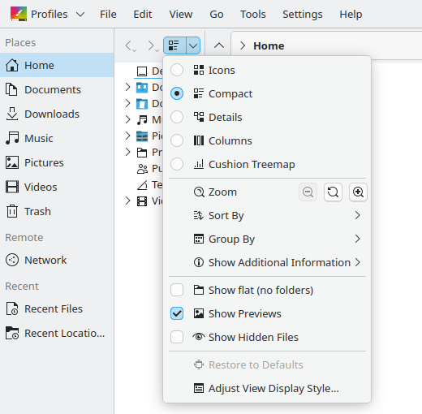
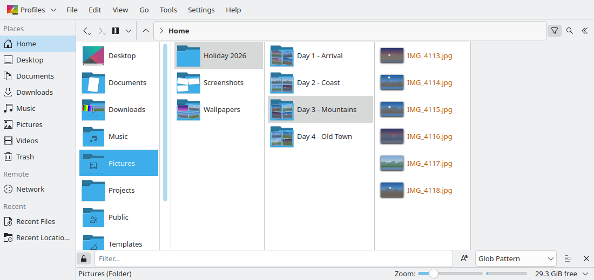
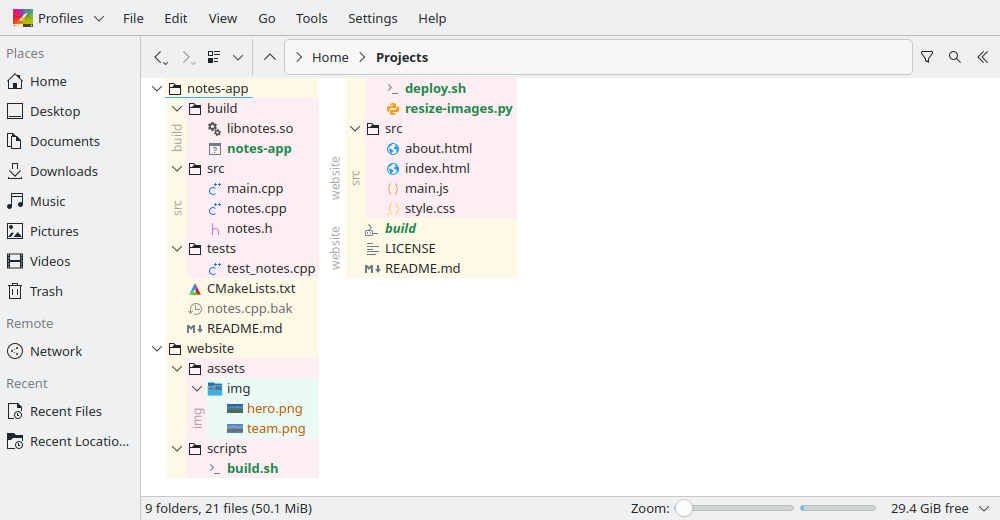
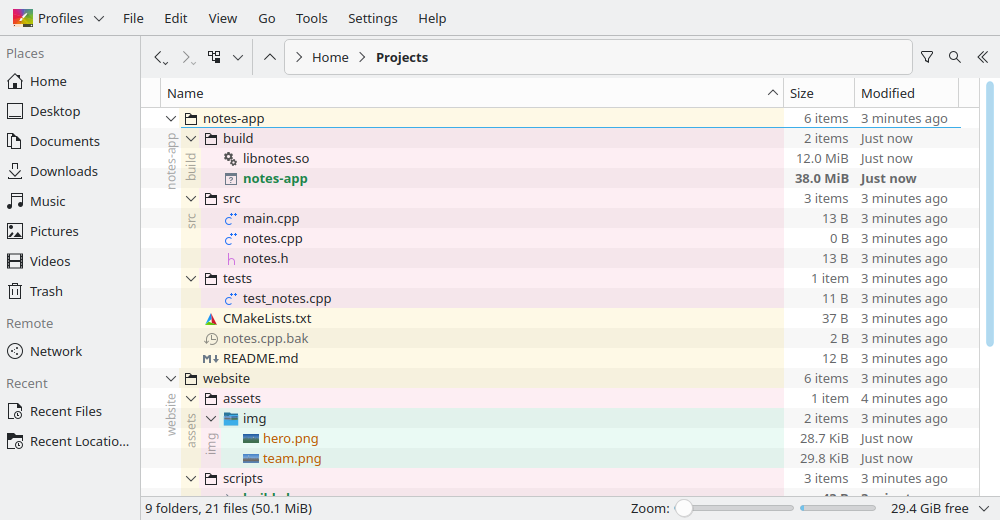
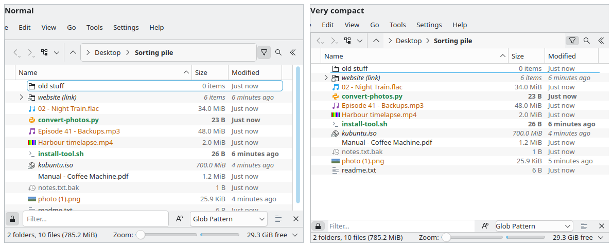
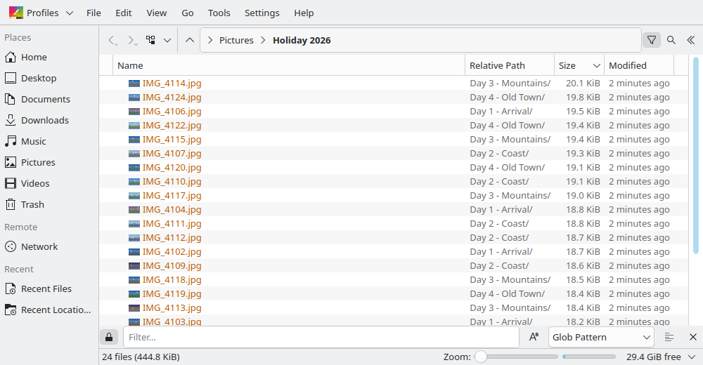

// SPDX-FileCopyrightText: 2026 Orcinus contributors
// SPDX-License-Identifier: GPL-2.0-or-later
//
// Source: .privatedoc/orcinus-handbook-raw/Views.md (German: Ansichten.md)

[#orcinus-views]
== Views

[#views-intro]
=== More than Icons, Compact and Details

Dolphin comes with three view modes: Icons, Compact and Details. Orcinus adds a few more and teaches the existing ones some new tricks.

All views sit together in the _View_ menu and in the view mode button of the toolbar. If there are more than five, they move into a _View Modes_ submenu so the menu doesn't burst at the seams.

.The view mode button with all views

[#views-columns]
=== The Columns view

The Columns view (_Ctrl+4_, also known as "Miller columns") comes from Dolphin's development version and is the fourth view mode in Orcinus, next to Icons, Compact and Details. Every folder along the path gets a column of its own. Select a folder and it opens in a new column to its right. If you've ever used a Mac, you'll feel right at home.

.The Columns view

Orcinus makes a few extra things possible:

* The Columns view can go into the toolbar and into profiles, including zoom and information density.
* In the split view, a Columns view stays a Columns view, even when it moves to another folder.
* Linked views work here too: the other view follows the folder opened last, and its selection shows up in that folder's column without anything being opened.
* The built-in viewer moves the selection in the column you opened it from.

Only _Show flat_ isn't available here. Each column shows exactly one folder, after all.

[#views-plugins]
=== View plugins

More views can be added as *plugins*. Orcinus ships one, the _Cushion Treemap_. It's so pretty that it gets <<orcinus-treemap,a chapter of its own>>.

The view you choose for a place is remembered by Orcinus for exactly that place (not for its subfolders), in the history and in the session. The display style saved for the folder stays untouched, so Dolphin doesn't notice any of this. Options a view can't handle stay visible but are grayed out.

[#views-expandable-compact]
=== Expandable folders in the Compact view

In the Details view you could always expand folders. Orcinus teaches this to the *Compact view* as well: with small arrows in front of the folders and without tree lines. It's switched on in _Settings → Configure Orcinus… → View → Compact → Folders: Expandable_, and it is on by default.

[#views-whole-branches]
==== Whole branches at once

Expanding one folder after another can be pretty tedious. That's why the following works in Compact, Details and in the _Folders_ panel:

* *Alt+click* on an arrow (or the **`+*+`** key) expands or collapses the **whole branch**, with all its subfolders.
* **`{plus}`* and *`+-+`** expand and collapse one level.

So that you don't accidentally pull your whole file system into the window, expanding whole branches doesn't follow symbolic links and stops after 10,000 items.

[#views-expansion-tint]
=== Colored backgrounds for expanded folders

In the Compact view, expanding has a catch: an expanded folder can wrap into the next column, and suddenly nobody knows where its contents start and where they end.

That's why Orcinus *tints the contents of expanded folders by their depth*. Every subfolder reads as one block. For deeper levels the colors repeat. And where there's room, the *names of the expanded folders run vertically* in the indentation next to their contents.

.Expanded, tinted subfolders in the Compact view. The folder "website" wraps into the second column, and its name runs vertically next to it.

In the Details view this works the same way in the name column. There, the folder names stay at the top while you scroll through a long folder, so you always know where you are. The tree lines of the Details view are replaced by the colors.

.Tinted subfolders in the Details view

On the settings page _View → Highlighting → Expanded Folders_ each of the two views has a setting of its own, with these presets:

* _Off_
* _Printer paper_: for nostalgics who still remember continuous paper with green stripes
* _Grey_
* _Pastel (Subtle)_
* _Pastel (Vivid)_: the default
* _Custom_: 2 to 10 colors of your own
* Details only: _Classic (tree lines)_, Dolphin's familiar look

The presets adapt to light and dark color schemes. You can switch the folder names off or make them more subtle with the _Name opacity_.

[#views-information-density]
=== Information density

Dolphin leaves 2 pixels of space above and below each item. Sounds like little, but with a few hundred files it adds up nicely.

On the settings pages _View → Icons / Compact / Details / Columns → Density_ you set this spacing for each view mode separately:

* *Normal:* 2 pixels, like in Dolphin.
* *Compact:* 1 pixel. This is the default for new users.
* *Very compact:* no spacing at all. With 16-pixel icons and the usual system font, a row is then about 18 instead of 22 pixels high. That's roughly 22% more files on screen, without buying a new monitor.
* *Custom:* the padding in pixels (0 to 10) and, in Compact, Details and Columns, the line height as a percentage of the font height (50 to 150%). Below 100%, the letters of neighboring rows can touch. Try it at your own risk.

.Normal on the left, Very compact on the right (information and bar density). On the right, all files fit into the window.

In the Compact view, the gap between the columns shrinks with the density as well (8, 6 and 4 pixels). The space to the left and right of icon and name stays as it is.

[#views-flat]
=== Show flat

Sometimes you don't care about the folders at all. You just want to see *all files*, for example all the photos from a vacation, no matter which day's folder they're in.

That's what _View → Show flat (no folders)_ is for. The view then shows all files from all subfolders in one single list, with no folders at all. In the Details view there's the _Relative Path_ column to go with it, so you still know where a file comes from.

.Flat view with the "Relative Path" column

Sorting, filtering, selecting and previews work as usual. Sorted by size, by the way, this finds the fattest chunks in a folder tree in no time. Orcinus remembers the setting for each place.

Since a flat view shows files from many folders, nothing can be created in it. Where would it go? _Create New_, _Paste_, _Duplicate_ and dropping via drag and drop are therefore grayed out and tell you why. Moving, deleting, renaming and opening work, of course.
